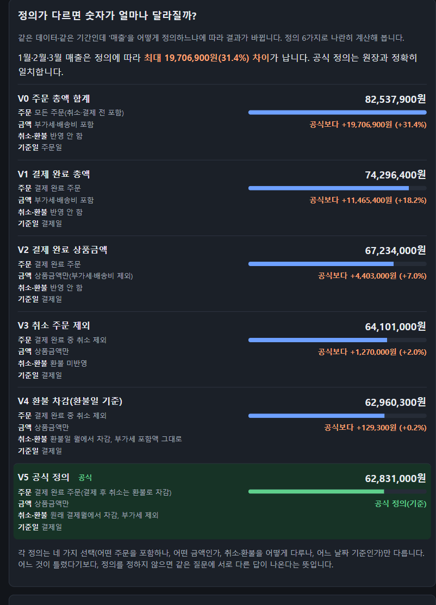

# realDefinition — 문제 정의 프레임워크 포트폴리오

## "이번 달 매출 알려줘" — 같은 데이터인데 정의에 따라 숫자가 최대 31% 갈립니다



**▶ [직접 눌러 보기: realdefinition.vercel.app](https://realdefinition.vercel.app)** (설치 없음, 합성 데이터, 첫 접속은 약 4초)

| 만들고 검증한 것 | 결과 |
|---|---|
| KPI 정의서를 LLM에 주면 SQL 정확도가 오르나 | **1~7% → 59~66%** (모델 2개) |
| 틀린 숫자를 걸러낼 수 있나 | 실제 LLM 오답 **14/14 검출**, 거짓 경보 0 |
| 그러면 성공인가 | **아니요, "판정 불명".** 같은 질문 5번의 일관성이 71~74%로, 실험 전에 정한 기준(90%)에 못 미쳤습니다 |

기준은 결과를 보기 전에 고정했고, 마음에 들지 않는 결과가 나와도 바꾸지 않았습니다. 한계와 실수까지 포함한 **1~2분 요약은 [PORTFOLIO.md](PORTFOLIO.md)**, 전체 근거는 아래 목차에 있습니다.

---

> 저장소: [sikomar00/realDefinition](https://github.com/sikomar00/realDefinition) · **공개 데모: [realdefinition.vercel.app](https://realdefinition.vercel.app)** (합성 데이터, 설치 없이 바로 체험)

> **처음 보시는 분은 [PORTFOLIO.md](PORTFOLIO.md)(1~2분 요약)부터 읽으세요.** 아래는 전체 문서 목차입니다.

> "모호한 요구를, 검증 가능한 과제로 바꾸고, 만들어 보고, 숫자와 기록으로 증명한다."
결과물만 보여 주는 것이 아니라 **왜 이 문제를 골랐고, 어떻게 생각했고, 무엇을 배웠는지**를 문서로 남깁니다.

## 앱 실행 (화면)

```powershell
python app/server.py
```

테스트는 `python app/test_app.py`, `python experiment/test_experiment.py`로 돌립니다. 기본 모드(로컬 SQLite)는 추가 설치 없이 Python만 있으면 `http://127.0.0.1:8765`에서 열립니다. 클라우드 DB(Supabase) 모드는 접속 도구 설치와 환경 설정이 필요합니다([12](docs/12-poc-desk-app.md)). 질문 → 정의 확인 → 계산 → 정답 대조 → 리포트 흐름을 눌러 볼 수 있습니다. 자세한 내용은 [docs/12-poc-desk-app.md](docs/12-poc-desk-app.md).

## 한 줄 요약

| 항목 | 내용 |
|---|---|
| 핵심 문제 | 지표 정의(예: "매출")가 문서화되지 않아 같은 질문에 담당자·AI마다 다른 숫자가 나옴 |
| 해결 방향 | 요구 한 줄 → 모호함 질문 → KPI 정의서 확정 → SQL 생성·실행 → 합계 검증 → PoC 리포트 |
| 핵심 결과 | 정의가 다르면 숫자 최대 **+36%** 차이 · KPI 사전으로 정확도 **+52~65%p** · 그러나 일관성 71~74%로 기준(90%) 미달이라 판정은 **"불명"** · 대사로 오답 **14/14** 검출 |
| 다룬 역량 | 데이터·AI: KPI 정의·Text-to-SQL·검증 / PoC: 설계·실험·문서화 |

## 작업 의도 문서

**[Intent.md](Intent.md)** — 작업마다 "문제 · 기대 결과 · 영향 범위 · 제약 · 열린 질문"을 먼저 쓰고, IA·UJ·PRD·ERD를 ID로 연결해 개발합니다. 지금 하고 있는 작업과 끝난 작업의 의도가 여기에 있습니다. 작업 규칙은 [CLAUDE.md](CLAUDE.md).

## 문서 읽는 순서

| 순서 | 문서 | 답하는 질문 | 상태 |
|---|---|---|---|
| 0 | [용어집](docs/00-glossary.md) | 이 문서에 나오는 말이 무슨 뜻인가? | draft |
| 1 | [문제 정의서](docs/01-problem-definition.md) | 무엇이 문제이고, 누구의 문제이며, 어떻게 알 수 있나? | draft |
| 2 | [사고 흐름 기록](docs/02-thinking-log.md) | 왜 그렇게 결정했나? 무엇을 버렸나? | draft |
| 3 | [PRD](docs/03-prd.md) | 무엇을 어디까지 만들고, 언제 성공이라 하나? | draft |
| 4 | [사용자 여정 · 크리티컬 여정 · 화면 흐름](docs/04-journey-and-flow.md) | 사용자는 어떤 길로 가고, 어디가 끊기면 안 되나? | draft |
| 5 | [데이터 설계](docs/05-data-design.md) | 어떤 데이터로 문제를 재현하고, 정답은 어떻게 정하나? | draft |
| 6 | [실험 설계](docs/06-experiment-design.md) | KPI 사전이 AI의 숫자를 정말 안정시키는지 어떻게 재나? | draft |
| 7 | [실험 결과](docs/07-experiment-results.md) | 실제로 재 보니 어땠나? (두 모델 완료, 종합 판정 불명) | draft |
| 8 | [후속 실험 설계(동결)](docs/08-experiment-v2-design.md) | 결과를 보고 고친 사전은 정말 나아졌나? 처음 보는 질문으로 어떻게 확인하나? | draft |
| 9 | [후속 실험 결과](docs/09-experiment-v2-results.md) | v2는 나아졌나? 부작용은? 검증 방법은 새 질문에서도 통하나? | draft |
| 10 | [회고](docs/10-retrospective.md) | 무엇을 배웠고, 무엇을 틀렸고, 다음에 무엇을 하나? | draft |
| 11 | [면접 준비 노트](docs/11-interview-prep.md) | 예상 질문에 어떤 근거로 답하나? 내 말로 설명할 수 있나? | draft |
| 12 | [realDefinition 앱](docs/12-poc-desk-app.md) | 설계한 흐름을 눌러 볼 수 있는 화면은? 무엇을 확인했고 무엇은 못 했나? | draft |
| 13 | [Supabase DB 기획·ERD](docs/13-supabase-db-plan.md) | 로컬 DB를 클라우드로 옮길 때 무엇을 어떻게 나누고 지키나? (합성 데이터는 이전·적용 완료, 가계부는 아직) | draft |
| 14 | [Supabase 구현 스펙·티켓](docs/14-supabase-spec-and-tickets.md) | 기획을 만들 수 있는 수준으로 내리면? 무엇으로 합격을 판정하나? (적용 결과와 점검 기록 포함) | draft |
| 15 | [Supabase QA 가이드](docs/15-supabase-qa-guide.md) | 만든 DB가 정말 동작하나? 직접 눌러 확인하는 방법과 QA가 찾은 문제는? (점검표는 스프레드시트에 따로 기록) | draft |

| 16 | [Vercel 공개 배포](docs/16-vercel-deployment.md) | 인터넷에 어떻게 올렸고, 무엇을 막았고, 배포하면서 무엇이 깨졌나? | draft |
| 17 | [구현 설계서](docs/17-technical-design.md) | 무슨 라이브러리·버전으로, 어느 파일이 무슨 일을, 어떤 순서로·어떻게 확인하며 만드나? 외부 한도와 위험은? | draft |

코드·데이터: `app/` (realDefinition 로컬 웹앱), `data/` (합성 샘플 DB 생성기, 정의별 검증 스크립트, 가계부 CSV 점검·정의별 계산·앱 합계 대조 스크립트), `experiment/` (실험용 KPI 사전, 질문 20개와 골드 답, H3 테스트 세트). 실데이터는 `data/private/`(Git 제외).


## 문서 규격 (모든 문서 공통)

1. **front-matter**: `id`, `title`, `status`(draft/review/final), `updated`, `depends_on`.
2. **고정 구조**: `요약 → 본문 → 📘 개념 학습 → 열린 질문 → 변경 이력`.
3. **📘 개념 학습 박스**: 그 문서에서 처음 나온 개념을 초보자 눈높이로 설명.
4. **결정은 근거와 함께**: "무엇을 / 왜 / 버린 대안"을 [사고 흐름 기록](docs/02-thinking-log.md)에 번호(D-001…)로 누적.
5. **가정은 가정이라고 표시**: `[가정]` 태그를 붙이고 검증 방법을 적음. 아직 확인하지 않은 것을 사실처럼 쓰지 않음.
6. **다이어그램은 Mermaid**: 텍스트라서 버전 관리와 비교가 쉬움.
