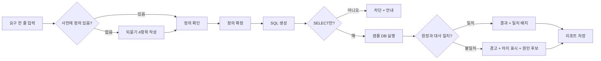
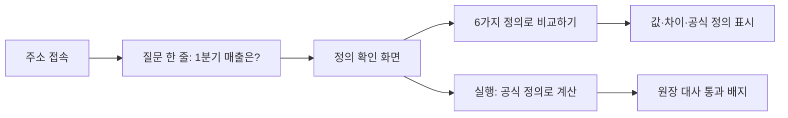
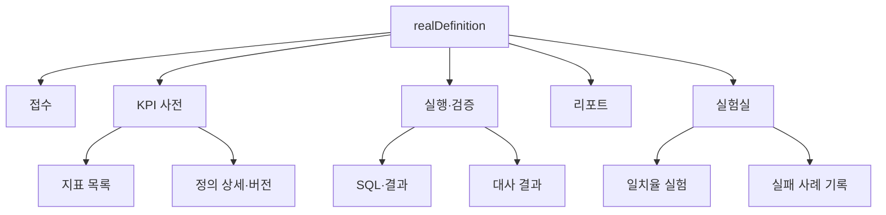
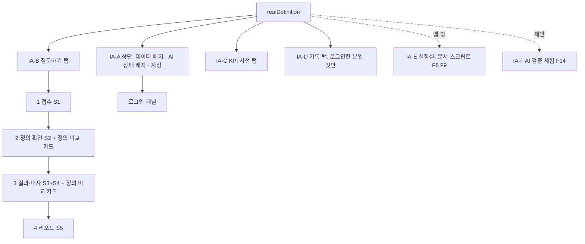
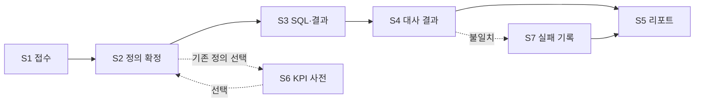

# 사용자 여정 · 크리티컬 여정 · 화면 흐름

## 요약
현업 정은이 "이번 달 매출"을 묻고 **믿을 수 있는 숫자**를 받기까지의 길을 그립니다. 그중 끊기면 제품 가치가 사라지는 한 길(크리티컬 여정)을 따로 떼어, 화면과 실패 처리까지 연결합니다.

## 1. 사용자 여정 (As-Is → To-Be)

### 1-1. As-Is: 지금의 여정
| 단계 | 행동 | 생각·감정 | 문제 지점 |
|---|---|---|---|
| 1 질문 | 메신저로 "이번 달 매출 뽑아 주세요" | 금방 되겠지 | 정의 설명 없음 |
| 2 대기 | 분석가가 자기 기준으로 쿼리 작성 | 불안 | 기준이 기억에 의존 |
| 3 수신 | 숫자 받음 | 어? 지난번과 다른데 | 비교 근거 없음 |
| 4 의심 | "이거 부가세 포함이에요?" 재질문 | 짜증, 불신 | 되묻기가 사후에 일어남 |
| 5 재작업 | 다시 계산 | 시간 낭비 | 반복 |

### 1-2. To-Be: 만들고자 하는 여정
| 단계 | 행동 | 생각·감정 | 시스템이 하는 일 |
|---|---|---|---|
| 1 질문 | 한 줄 입력 | 부담 없음 | 사전에서 지표 탐색 |
| 2 확정 | 되묻기 4개에 답하거나 기존 정의 선택 | 내가 원한 게 뭔지 정리됨 | 빈 항목만 질문 |
| 3 계산 | 결과 표 확인 | 기대 | 확정 정의로 SQL 생성·실행 |
| 4 신뢰 | "원장과 일치" 배지 확인 | 안심 | 자동 대사 |
| 5 기록 | 리포트 저장 | 다음에 재사용 | 정의 버전·SQL·결과 연결 |

> 📘 **개념 학습 — 여정 지도는 "화면"이 아니라 "사람의 상태"를 그린다**
> 화면보다 먼저 사용자의 생각과 감정을 그려야, 어디에 기능이 필요한지가 보입니다. 위 표에서 "4 의심"이 To-Be의 "2 확정"으로 앞당겨진 것이 핵심 설계입니다.

## 2. 크리티컬 사용자 여정 (CUJ)

**CUJ-1: 질문 → 확정된 정의 → 검증된 숫자**

이 여정이 막히면 앱의 존재 이유가 사라집니다. 그래서 가장 먼저 만들고, 가장 먼저 테스트합니다.

### CUJ-1 단계별 성공·실패 정의

| 단계 | 성공 | 실패 시 사용자에게 보이는 것 | 대응 기능 |
|---|---|---|---|
| 입력 | 한 줄 접수 | 빈 입력 안내 | F1 |
| 되묻기 | 필수 4항목 충족 | 비어 있는 항목 강조, 확정 비활성 | F2 |
| SQL 생성 | 사전의 정의 반영 | "사전에 없는 지표입니다. 먼저 정의해 주세요" | F4 |
| 안전 검사 | SELECT만 | 쓰기 구문 차단 | 비기능 |
| 실행 | 표 표시 | 오류 메시지와 로그 | F5, F9 |
| 대사 | 차이 0 | 차이 금액과 원인 후보 | F6 |

### CUJ-1 수용 테스트 (예시)
1. 정의 없는 "매출"을 입력하면 → 되묻기 4개가 나온다.
2. 4개를 모두 채우기 전에는 확정 버튼이 비활성이다.
3. 확정 후 SQL이 부가세 제외, 취소 제외, 결제일 기준을 반영한다.
4. 합계가 원장과 같으면 일치 배지, 의도적으로 틀린 SQL이면 경고가 나온다.

### CUJ-2: 공개 방문자 — 설치 없이 "정의가 숫자를 바꾼다"를 본다 (구현, F11·F12)

| 단계 | 성공 | 실패 시 보이는 것 | 대응 |
|---|---|---|---|
| 접속 | 로그인 없이 화면이 열림 | 속도 제한 안내(429) | F12, NF6 |
| 비교 | 정의 6가지 값과 "최대 N원(%) 차이" | 오류 문구 | F11 |
| 실행 | 값 + 원장 대사 통과 | 오류 문구 | F4~F6 |
| 막힌 기능 | AI 선택지가 비활성이고 이유 표시 | — | F13 |

### CUJ-3: 본인 — 로그인해서 라이브 AI로 실행하고 기록을 남긴다 (구현, F10·F13)
로그인 → 질문 → 정의 확인 → 실행 방식에서 "AI가 SQL 생성" 선택 → 실행(10~35초) → 대사 2건(원장, 기준 계산식) → 리포트 → 기록 탭에서 본인 것만 확인. 실패 시: 틀린 비밀번호 안내, 본인 계정이 아니면 거절, 시간 초과 오류 기록.

### CUJ-4: 방문자 — AI가 만든 SQL이 검증에서 걸리는 모습을 본다 (제안, F14)
방문자가 키 없이 실험 기록(실제 모델이 만든 정답·오답 SQL) 중 하나를 고르면, 앱이 같은 안전 검사 → 읽기 전용 실행 → 대사를 거쳐 통과/경고를 보여 준다. **"녹화된 실제 출력"임을 표시**하고 정답:오답의 실제 비율을 함께 보여 준다. 상세는 [Intent](../Intent.md) INT-006.

## 3. 정보 구조 (IA)

| 메뉴 | 목적 | 기능 ID |
|---|---|---|
| 접수 | 요구 입력과 되묻기 | F1, F2 |
| KPI 사전 | 정의 저장·버전 | F3 |
| 실행·검증 | SQL 생성·실행·대사 | F4, F5, F6 |
| 리포트 | 결과 md 내보내기 | F7 |
| 실험실 | 일치율·실패 기록 | F8, F9 |

### 3-2. 구현된 정보 구조 (2026-10-20 기준, 개발 시 이쪽을 기준으로 한다)

설계 당시의 메뉴(위)와 실제 앱은 다르다. 실제 앱은 **상단(배지·계정) + 탭 3개**이고, "질문하기" 탭 안에서 4단계가 순서대로 진행된다.

| IA ID | 영역 | 목적 | 기능 ID | 비고 |
|---|---|---|---|---|
| IA-A | 상단(배지·계정) | 데이터 출처(Supabase/SQLite)·AI 상태·로그인 | F10, F12, F13 | 계정 영역은 Supabase 모드에서만 |
| IA-B | 질문하기 | 접수 → 정의 확인 → 결과·대사 → 리포트 | F1, F2, F4~F7, F11 | S1~S5 |
| IA-C | KPI 사전 | 지표 정의·버전 | F3 | S6 |
| IA-D | 기록 | 실행 기록 조회 | F9(부분), F10 | S7 대신 "실행 기록" 표. 로그인한 본인만 |
| IA-E | 실험실 | 일치율 실험·실패 사례 | F8, F9 | **앱 밖**(문서 06~09, `experiment/`) |
| IA-F | AI 검증 체험 | 녹화된 AI 출력의 검증 재생 | F14 | 제안(미착수) |

## 4. 화면 흐름

| 화면 | 핵심 요소 | 빈 상태 | 오류 상태 |
|---|---|---|---|
| S1 접수 | 입력창, 예시 질문 | 예시 질문 칩 표시 | 빈 입력 안내 |
| S2 정의 확정 | 4항목 폼, 진행률, 확정 버튼 | 사전 검색 결과 없음 → 새 정의 작성 | 필수 누락 강조 |
| S3 SQL·결과 | SQL 보기, 결과 표, 실행 시간 | — | 실행 오류와 로그 |
| S4 대사 결과 | 원장 합계 vs 결과 합계, 일치 배지 | — | 차이 금액·원인 후보 |
| S5 리포트 | md 미리보기, 내보내기 | — | — |
| S6 KPI 사전 | 지표 목록, 버전 비교 | 등록된 지표 없음 | — |
| S7 실패 기록 | 오류·원인·조치 입력 | 기록 없음 | — |

**실제 구현과의 대응 (2026-10-20):** S3(SQL·결과)와 S4(대사 결과)는 한 화면("3 결과·대사")에서 보여 준다. S7(실패 기록)은 별도 화면이 아니라 "기록" 탭의 실행 기록 표로 구현했다. 새로 생긴 요소: **정의 비교 카드**(S2·S3, F11), **로그인 패널**(상단, F10), **AI 선택지 비활성 안내**(S2, F13).

> 📘 **개념 학습 — 빈 상태와 오류 상태를 처음부터 그린다**
> 초보 설계는 "잘 되는 화면"만 그립니다. 하지만 사용자는 데이터가 없을 때, 오류가 났을 때 가장 헷갈립니다. 화면마다 정상·빈·오류 3상태를 적는 습관이 품질을 가릅니다.

## 5. 공고별 적용 시나리오 (같은 프레임, 다른 입력)

| 공고 | 입력 예시 | 프레임에서 달라지는 점 |
|---|---|---|
| AI-BI | "이번 달 재구매율 알려 줘" | KPI 사전·SQL 중심 |
| R&D·PoC | "새 임베딩 모델이 쓸 만한지 검토" | 정의 4항목 대신 PoC 4항목(문제, 성공 기준, 검증 방법, 한계) |

PoC 4항목 변형은 05 이후에 별도 양식으로 확정한다.

## 열린 질문
- ~~Q5~~ 확정: 필수 4항목 고정, 보조 질문만 LLM (D-009)
- ~~Q6~~ 확정: Mermaid까지, 구현 후 스크린샷으로 대체 (D-010)

## 변경 이력
- 2026-10-20 CUJ-2~4 추가, 구현된 IA(IA-A~F)와 화면 대응 추가 (Intent.md 도입)
- 2026-10-19 초안 작성
- 2026-10-19 Q5, Q6 확정 반영
