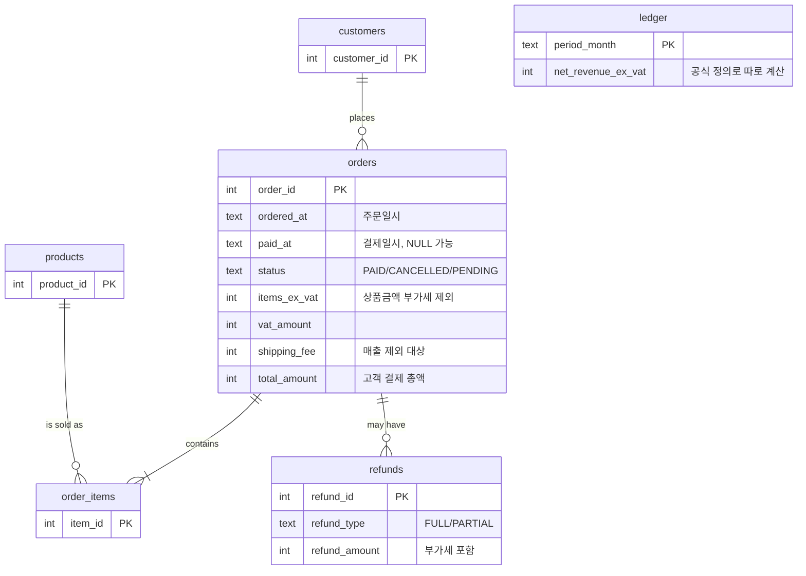

# 데이터 설계

## 요약
온라인 주문 도메인의 **합성(가짜) 데이터** SQLite DB를 만들었습니다(주문 500건, 2026-01~03).
"매출"이라는 한 단어가 **정의 선택에 따라 얼마나 다른 숫자가 되는지**를 일부러 드러내도록 설계했고,
공식 정의로 계산한 SQL 결과가 별도 계산한 원장과 일치함을 확인했습니다.

| 산출물 | 위치 |
|---|---|
| 생성 스크립트 (seed 고정, 항상 같은 결과) | `data/generate_sample_db.py` |
| 샘플 DB | `data/poc_desk_sample.db` |
| 정의별 숫자 검증 스크립트 | `data/verify_definitions.py` |
| 검증 출력 기록 | `data/verify_output.txt` |

재생성: `python data/generate_sample_db.py` → 검증: `python data/verify_definitions.py`

## 1. 테이블 구조 (ERD)



| 테이블 | 행 수 | 역할 |
|---|---|---|
| customers | 15 | 가상 고객 |
| products | 8 | 상품 (단가는 부가세 제외) |
| orders | 500 | 주문. 금액·상태·시각을 모두 가짐 |
| order_items | 1,017 | 주문 상세 라인 |
| refunds | 52 | 환불 (전액 21 + 부분 31) |
| ledger | 3 | **정답표.** 월별 공식 매출. SQL이 아니라 파이썬으로 독립 계산 |

> 📘 **개념 학습 — 테이블, 키, 관계**
> 테이블은 엑셀 시트 하나, 행은 한 건의 기록, 열은 속성입니다. `PK`(기본키)는 행을 구별하는 번호이고, `orders.customer_id`처럼 다른 테이블의 PK를 가리키는 열을 `FK`(외래키)라고 합니다. FK 덕분에 "이 주문은 누구의 것인가"를 `JOIN`으로 이어서 묻습니다. 위 ERD의 선이 그 연결입니다.

> 📘 **개념 학습 — 합성 데이터와 seed**
> 합성 데이터는 규칙에 따라 만든 가짜 데이터입니다. `seed=42`로 난수를 고정하면 몇 번을 다시 만들어도 같은 DB가 나옵니다. 실험이 **재현**되어야 "정의를 바꿨더니 일치율이 올랐다"를 믿을 수 있습니다.

## 2. 의도적으로 심은 정의 충돌

| # | 충돌 | 데이터에서 만든 상황 | 건수(검증 결과) |
|---|---|---|---|
| ① | **부가세·배송비** 포함 여부 | 모든 주문에 부가세 10% 와 3,000원 배송비(5만원 미만) | 전 주문 |
| ② | **취소**를 어떻게 셀까 | 결제 전 취소(결제일 없음) / 결제 후 취소(전액 환불 기록) 두 종류 | 18건 / 21건 |
| ③ | **부분 환불** | 상품금액의 일부만 환불. 환불액은 부가세 포함으로 저장 | 31건 |
| ④ | **결제일 vs 주문일** | 월말 밤(22~23시) 주문이 다음 달에 결제됨 | 22건 |
| ⑤ (추가) | 환불을 **어느 월**에 귀속? | 결제월과 환불월이 다른 환불 | 16건 |
| ⑥ (추가) | **결제 전(PENDING)** 주문 | 아직 매출이 아닌 주문 | 26건 |

> 📘 **개념 학습 — 왜 일부러 어렵게 만드나**
> 정의가 충돌하지 않는 데이터에서는 KPI 사전이 있든 없든 답이 같아서 H1(사전이 일치율을 높인다)을 검증할 수 없습니다. 실험이 의미 있으려면 **"틀리기 쉬운 지점"이 데이터에 있어야** 합니다. 대신 이 DB의 한계도 정직하게 적습니다(5절).

## 3. 공식 정의 (KPI 사전 v1 초안)

문제 정의서의 필수 4항목(계산식, 포함·제외, 기간 기준, 단위)에 맞춰 적습니다.

| 항목 | 값 |
|---|---|
| 지표명 | 월 매출 (net_revenue) |
| 계산식 | 결제 완료 주문의 상품금액 − 환불액(부가세 제외) |
| 포함·제외 | 부가세 제외, 배송비 제외, PENDING 제외, 결제 전 취소 제외. 결제 후 취소는 전액 환불로만 차감(이중 차감 금지) |
| 기간 기준 | 결제일(`paid_at`). 환불은 원 결제월에서 차감 |
| 단위 | 원(KRW), 소수점 없음 |
| 환불 변환 | 전액 환불은 `items_ex_vat` 전체, 부분 환불은 `refund_amount × 100 / 110` |

## 4. 같은 '매출'인데 숫자가 이렇게 다르다 (검증 결과)

정의를 **하나씩만** 다르게 골라 SQL로 계산한 값입니다(단위: 원). 출처: `data/verify_output.txt`.

| 정의 | 2026-01 | 2026-02 | 2026-03 |
|---|---:|---:|---:|
| **원장(정답)** | **23,304,000** | **18,287,000** | **21,240,000** |
| V0 모든 주문 총액, 주문일 기준 | 31,776,600 | 25,037,800 | 25,723,500 |
| V1 결제완료 총액(부가세·배송비 포함), 결제일 | 27,600,400 | 22,128,400 | 24,567,600 |
| V2 결제완료 상품금액, 취소·환불 미반영 | 25,004,000 | 20,024,000 | 22,206,000 |
| V3 V2에서 CANCELLED 제외, 환불 미반영 | 23,818,000 | 18,652,000 | 21,631,000 |
| V4 V3 + 환불 차감(환불월 귀속, 부가세 포함액 그대로) | 23,571,600 | 18,280,200 | 21,108,500 |
| **V5 공식 정의** | **23,304,000** | **18,287,000** | **21,240,000** |

- 1월 기준 가장 단순한 V0(31.8M)은 정답(23.3M)보다 **약 36% 크다.** 같은 "매출"이라는 이름으로 보고되면 의사결정이 달라질 크기입니다.
- V4는 정답에 꽤 가깝지만 **여전히 틀립니다**(3월 −131,500원). 이런 "거의 맞는 오답"이 가장 위험합니다. 합계 대사(F6)가 필요한 이유입니다.
- 공식 SQL(V5)은 원장과 **3개월 모두 일치(PASS)** 했습니다.

공식 정의 SQL (V5):

```sql
SELECT strftime('%Y-%m', o.paid_at) AS month,
       SUM(o.items_ex_vat)
       - COALESCE(SUM(CASE r.refund_type
                        WHEN 'FULL' THEN o.items_ex_vat
                        ELSE r.refund_amount * 100 / 110 END), 0) AS net_revenue
FROM orders o
LEFT JOIN refunds r USING (order_id)
WHERE o.paid_at IS NOT NULL
GROUP BY month;
```

> 📘 **개념 학습 — LEFT JOIN과 중복 집계의 함정**
> 주문 한 건에 환불이 여러 건 붙으면 `JOIN` 결과에서 주문 행이 환불 수만큼 복제되어 `SUM(items_ex_vat)`가 부풀 수 있습니다. 이 DB는 주문당 환불을 최대 1건으로 만들어 이 문제를 피했지만, **실제 업무 데이터에서는 가장 흔한 SQL 오류 중 하나**입니다. 환불을 주문 단위로 먼저 합친 뒤 JOIN하는 방식이 안전합니다. (PoC 실험의 오류 SQL 테스트 세트에 이 유형을 넣을 예정)

> 📘 **개념 학습 — 대사(Reconciliation)**
> 서로 다른 방법으로 구한 두 숫자를 맞춰 보는 일입니다. 여기서는 (a) 파이썬이 규칙대로 계산해 저장한 `ledger`와 (b) SQL 결과를 비교합니다. 두 방법이 **독립적일수록** 같은 실수를 같이 할 확률이 낮아져 검증 힘이 커집니다.

## 5. 한계 (정직하게)

| 한계 | 영향 | 대응 |
|---|---|---|
| 원장도 내가 정한 규칙으로 계산한 값이다 | "정답"은 **정의 v1에 대한 정답**이지 현실의 진리가 아님 | 문서에 명시. 실제 프로젝트에서는 회계 확정치와 대사 |
| 환불은 주문당 최대 1건 | 중복 집계 함정이 데이터에는 안 드러남 | 오류 SQL 테스트 세트에서 별도로 다룸 |
| 고객 15명, 상품 8종, 3개월 | 현실의 복잡도·성능 문제 없음 | PoC 목적(정의 충돌 재현)에 한정 |
| 부가세율 10% 단일, 쿠폰·포인트 없음 | 할인 정의 충돌 미포함 | 필요 시 v2에서 추가 |
| 시각은 단일 시간대 가정 | 시간대 경계 문제 없음 | 범위 밖 |

## 6. 다음 단계와의 연결

| 이 문서의 산출물 | 쓰이는 곳 |
|---|---|
| `ledger` | F6 대사 기능의 정답값 |
| V0~V4 | H3 검증용 "틀린 SQL" 테스트 세트의 씨앗 |
| 3절 KPI 정의 | F3 KPI 사전의 첫 등록 지표, F4 SQL 생성 시 참조 |
| 정의 충돌 ①~⑥ | F8 일치율 실험의 질문 20개 설계 |

## 7. 사례 B: 실제 거래내역 (로컬 전용)

> 공개 문서이므로 **건수와 구조만** 적고 금액·거래처·계좌 정보는 적지 않습니다. 금액이 들어 있는 점검 결과는 `data/private/profile_output.txt`(Git 제외)에만 있습니다. (결정 D-013)

### 7-1. 데이터 개요 (`data/profile_bank_export.py`로 점검)

| 항목 | 값 |
|---|---|
| 출처 | 뱅크샐러드 가계부 앱 내보내기 CSV |
| 기간 | 2025-10-19 ~ 2026-10-19 (1년) |
| 행 수 | 1,770 (지출 977 / 이체 620 / 수입 173) |
| 열 | 날짜, 시간, 타입, 대분류, 소분류, 내용, 금액, 화폐, 결제수단, 메모 |
| 형식 | UTF-8(BOM), 쉼표 구분. 화폐는 전부 KRW |
| 결제수단 | 15종 (통장, 간편결제(머니), 간편결제(포인트), 체크카드 등이 섞임) |
| 빈 값 | 메모 열만 거의 비어 있음(1,765건). 나머지 열은 빈 값 없음 |

### 7-2. 점검에서 드러난 정의 충돌 (월 지출을 구할 때)

| # | 충돌 | 확인된 규모 | 잘못 계산하면 |
|---|---|---:|---|
| B1 | **내계좌이체** 양쪽 기록의 짝이 맞지 않음 | 446건, 합계 ≠ 0 | 한쪽만 기록되었거나 연동 안 된 계좌가 있다는 신호. 이체를 지출/수입에 넣으면 부풀거나 줄어듦 |
| B2 | 타입은 `이체`인데 내계좌이체가 **아닌** 것 | 174건 | 송금·결제·저축·투자가 섞여 있어 지출로 볼지 판단이 갈림 |
| B3 | 타입 `지출`인데 금액이 **양수** | 85건 | 환불·취소·정산으로 추정(`[가정]`, 확인 필요). 단순 합계는 맞게 줄지만, "지출 건수"나 "절댓값 합"은 틀림 |
| B4 | 타입 `수입`인데 금액이 **음수** | 3건 | 부호 규칙 예외. 수입 합계가 틀어짐 |
| B5 | 대분류 **미분류** | 158건 | 카테고리별 지출 계산에서 누락되거나 한 칸에 몰림 |
| B6 | **같은 행 중복** (날짜·시간·금액·결제수단·내용 동일) | 25건 | 중복 입력인지, 정상 반복 결제(예: 교통)인지 구분 필요 |
| B7 | **포인트·머니** 결제 | 간편결제(포인트) 104건, 간편결제(머니) 546건 | 충전(이체)과 결제(지출)를 둘 다 세면 이중 계산, 포인트는 현금 지출인지 정의 필요 |
| B8 | **날짜 경계** | 00~05시 77건, 월말 22시 이후 6건 | 새벽·월말 거래의 월 귀속이 기준(거래 시각 vs 정산일)에 따라 달라짐 |
| B9 | 월별 **이체 금액 편차**가 매우 큼 | 특정 월에 매우 큰 이체(금액 비공개) | 이체를 포함하면 월 비교가 무의미해짐 |

> 📘 **개념 학습 — 사례 A와 B는 같은 병이다**
> A(주문)의 "결제일 vs 주문일"은 B의 "새벽·월말 거래 귀속(B8)"과, A의 "취소·환불"은 B의 "지출 양수(B3)"와, A의 "부가세·배송비 제외"는 B의 "이체·충전 제외(B1·B2·B7)"와 같은 구조입니다. 즉 **"무엇을 세고(포함·제외), 언제로 세고(기간 기준), 반대 방향 거래를 어떻게 처리하나(환불·취소)"** 세 질문이 데이터가 달라도 반복됩니다. 이 반복되는 질문이 KPI 사전의 필수 4항목이 되는 근거입니다.

### 7-3. 월 지출 정의 v1 (초안 → 7-10에서 두 지표로 분리 확정)

| 항목 | 초안 | 상태 |
|---|---|---|
| 지표명 | 월 지출 (monthly_spending) | — |
| 계산식 | 타입=`지출`인 거래 금액 합계의 절댓값. 양수 지출(환불 추정)은 차감 | `[가정]` B3가 환불인지 확인 후 확정 |
| 포함·제외 | 포함: 타입=`지출` 전체(양수는 환불로 보고 차감), **대분류 `저축`·`투자` 이체**(사용자 결정 D-014). 제외: 내계좌이체, 그 외 `이체`, 수입. 중복 의심 행(B6)은 일단 포함하고 별도 표시 | `[가정]` 저축·투자의 부호 처리는 아래 참고 |
| 기간 기준 | 거래 날짜(`날짜` 열), 시각 무관 | `[가정]` |
| 단위 | 원(KRW), 소수점 없음 | 확정 |
| 저축·투자 부호 처리 | 저축: 점검 결과 **전부 `이체`·양수(48건)** 라서 기록 방향을 믿을 수 없다고 보고 `절댓값`을 지출로 계산. 투자: 음수(12건)는 투입(지출), 양수(8건)는 회수(차감)로 **순투입** 계산 | `[가정]` 통장 잔액 변동(정답 후보 3)으로 검증 필요 |

### 7-4. 정답표(원장) 후보

| 후보 | 방법 | 강도 | 한계 |
|---|---|---|---|
| 1 | 앱 화면의 월별 지출 합계를 12개 직접 기록해 비교 | 중 | 앱의 정의이지 진리가 아님. 앱 정의와 내 정의가 다르면 불일치가 오히려 정보가 됨 |
| 2 | 내계좌이체 합계가 0인지 점검 (현재 ≠ 0) | 중 | 짝 안 맞는 이유를 찾는 진단 도구 |
| 3 | 통장 잔액 변동 = 수입 − 지출 ± 이체 순유출 | 높음 | 모든 계좌 잔액이 필요하고, 연동 안 된 계좌가 있으면 안 맞음 |

사례 A의 `ledger`와 달리 사례 B의 정답은 **외부 출처(앱 화면, 통장 잔액)** 입니다. 이쪽이 대사의 힘이 더 큽니다.

### 7-5. 로컬 적재 원칙
- 원본 `data/private/transaction.csv`는 수정하지 않는다.
- 적재 DB(`data/private/*.db`)에는 `내용`(거래처명), 이름 포함 문자열을 **해시 또는 일련번호로 치환**한 열만 남긴다.
- LLM에는 테이블 구조와 KPI 사전만 전달하고 거래 행은 보내지 않는다.

### 7-6. 정의별 월 지출 — v1 대비 차이 비율 (공개 가능한 결과)

정의를 **하나씩만** 바꿔 SQL로 계산하고, 공식 v1(W4)을 기준(0%)으로 얼마나 달라지는지만 적었습니다. 금액은 `data/private/variants_amounts.txt`(Git 제외)에만 있습니다. 완전한 11개월(2025-11 ~ 2026-09) 기준이며, 첫 달과 마지막 달은 일부만 있어 제외했습니다. 코드: `data/compute_spending_variants.py`

| 정의 | 11개월 합계 차이 | 월별 최소 | 월별 최대 |
|---|---:|---:|---:|
| W0 지출 타입의 절댓값 합 (양수=환불도 더함) | −10.9% | −52.4% | +174.8% |
| W1 지출 타입 합계 (이체 전부 제외) | −22.9% | −54.6% | +92.3% |
| W2 W1 + 이체 중 나간 돈 전부 (내계좌이체 포함) | +27.8% | −3.2% | +410.1% |
| W3 W1 + 내계좌이체 제외한 이체 중 나간 돈 | −20.2% | −43.8% | +111.6% |
| **W4 공식 v1** | **0%** | 0% | 0% |
| W5 v1에서 같은 행 중복 25건 제거 | −0.1% | −0.6% | 0.0% |
| W6 v1에서 포인트 결제 제외 | −0.2% | −1.4% | 0.0% |
| W7 v1이되 05시 이전 거래는 전날로 귀속 | 0.0% | 0.0% | 0.0% |

**읽는 법과 발견**

1. **이체와 저축·투자를 어떻게 다루느냐**(W1~W3)가 숫자를 가장 크게 흔듭니다. 한 달 기준으로 정의에 따라 최대 +410%, 합계도 −23%~+28%까지 벌어집니다. 사례 A에서 "주문 총액 vs 공식"이 36% 벌어진 것보다 큽니다.
2. **환불(양수 지출) 처리**(W0)만 바꿔도 합계가 약 11% 달라집니다. 단, 이는 B3의 양수 85건이 환불이라는 `[가정]` 위의 결과입니다.
3. 반대로 **중복 행, 포인트 결제, 새벽 귀속**(W5~W7)은 이 데이터에서는 영향이 1% 안팎이거나 거의 없습니다. 충돌이 있다고 해서 모두 중요한 것은 아니며, **측정해 보고 우선순위를 정해야 한다**는 것을 보여 줍니다. (사례 A에서 "결제일 vs 주문일" 하나만의 영향은 아직 따로 재지 않았으므로, 두 사례의 충돌별 영향 비교는 이후 과제입니다.)
4. 이 표는 v1과의 **상대 차이**이지 정답과의 차이가 아닙니다. v1 자체의 정확성은 7-4의 정답 후보(통장 잔액 변동, 앱 월 합계)로 아직 검증하지 못했습니다.

> 📘 **개념 학습 — 민감도 분석**
> "정의를 하나 바꾸면 결과가 얼마나 변하는가"를 재는 일입니다. 모든 불확실성을 똑같이 걱정하지 않고, 결과를 크게 흔드는 것부터 확정하고 문서화하기 위한 방법입니다. KPI 사전의 필수 4항목 중 무엇을 가장 먼저 되물어야 하는지도 이 표가 알려 줍니다(여기서는 "이체를 포함하나?", "환불은?").

### 7-7. 이 결과가 realDefinition 설계에 주는 것
- 되묻기 4항목 중 **포함·제외**(이체·저축·투자·환불)를 가장 앞에 둔다(F2의 질문 순서).
- 대사(F6)는 **정답 후보 3(잔액 변동)** 을 우선 구현 대상으로 한다.
- 일치율 실험(F8)의 질문 20개는 영향이 큰 충돌(W0~W3)에 집중하고, 영향이 작은 충돌(W5~W7)은 소수만 넣는다.

### 7-8. 앱 화면 합계와 대조하기 (정답 후보 1)

**입력 방법** — `data/private/app_monthly_totals.csv` (Git 제외, 양식은 이미 만들어 둠)

```
month,app_spending
2025-11,1234567      ← 뱅크샐러드 앱의 해당 월 '지출' 합계(원, 양수). 모르는 달은 비워 둠
```

- 대상은 완전한 11개월(2025-11 ~ 2026-09)입니다. 앱에서 월을 바꿔 가며 지출 총액을 옮겨 적으면 됩니다.
- 앱에 같은 월 합계가 "수입/지출/이체"로 나뉘어 있으면 **지출 총액**만 적습니다.

**실행:** `python data/compare_with_app.py` → 8가지 정의 중 앱 숫자에 가장 가까운 순서(MAPE)로 표를 출력하고, 금액 표는 `data/private/app_compare_amounts.txt`에 저장합니다.

**결과 해석**

| 결과 | 의미 |
|---|---|
| W1이 거의 정확히 일치 | 앱은 `지출` 타입만 합산(이체 제외). 내 v1(저축·투자 포함)과 정의가 다르므로, 차이는 오류가 아니라 **정의 차이**로 문서화 |
| W4(v1)가 일치 | 앱도 저축·투자를 지출로 셈 |
| 어느 것도 안 맞음 | 앱이 쓰는 숨은 규칙이 있다는 뜻. 달별 차이 패턴으로 원인(환불 처리, 특정 카테고리 제외 등)을 추적 |

> 📘 **개념 학습 — 정답과 일치하지 않는다고 틀린 것은 아니다**
> 앱의 월 합계는 "앱의 정의"로 계산한 값입니다. 내 정의와 다르면 숫자가 달라지는 게 당연하고, **어떤 정의의 숫자와 같은지를 찾는 것**이 곧 상대방의 정의를 역으로 확인하는 일입니다. 현업 인터뷰가 어려운 상황(D-006)에서 "남이 쓰는 지표 정의를 데이터로 역추적"하는 연습이 되고, 되묻기 4항목이 필요한 이유의 실제 증거가 됩니다.

> `[검증함]` 스크립트는 가짜 입력으로 먼저 시험했고(W1이 MAPE 0.0%로 1등), 이후 실제 앱 값으로 실행했습니다. 결과는 7-9에 있습니다. (엑셀에서 붙여 넣은 탭 구분 파일도 읽도록 보강함)

### 7-9. 앱 화면 합계 대조 결과

앱 화면의 월별 지출 합계 11개월(2025-11 ~ 2026-09)을 입력해 8가지 정의와 대조했습니다. 금액 표는 `data/private/app_compare_amounts.txt`(Git 제외)에 있습니다.

| 정의 | 앱 합계 대비 평균 오차(MAPE) | 월별 범위 | 정확히 일치한 달 |
|---|---:|---|---:|
| **W1 지출 타입 합계 (양수는 환불로 차감, 이체 전부 제외)** | **0.0%** | ±0.0% | **11 / 11** |
| W3 W1 + 이체 중 나간 돈(내계좌이체 제외) | 4.4% | 0% ~ +25.8% | 1 / 11 |
| W0 지출 타입의 절댓값 합 (양수도 더함) | 19.3% | +0.5% ~ +47.9% | 0 / 11 |
| W4 공식 v1 (W1 + 저축·투자) | 25.7% | −48.0% ~ +120.3% | 0 / 11 |
| W5, W6, W7 (v1의 변형) | 25.6~25.7% | −48% ~ +120% | 0 / 11 |
| W2 W1 + 이체 전부 | 74.0% | +9.5% ~ +165.2% | 0 / 11 |

**발견**

1. **앱의 "월 지출" = W1.** 11개월 모두 원 단위까지 일치했습니다. 앱은 타입이 `지출`인 거래만 더하고, 양수(환불로 추정)는 차감하며, **이체(저축·투자 포함)는 지출에 넣지 않습니다.**
2. **B3(양수 지출 85건)은 환불로 차감하는 것이 맞습니다.** 양수를 더해 버리는 W0은 11개월 모두 불일치했고, 차감하는 W1만 일치했습니다. 앱의 계산 방식과 같다는 뜻이며, 양수 한 건 한 건이 실제로 환불이라는 것까지 증명하는 것은 아닙니다(`[가정]` 유지).
3. **내 v1(W4)은 앱과 −48% ~ +120% 다릅니다.** 오류가 아니라 **내가 정한 정의(D-014: 저축·투자 포함)가 앱의 정의와 다른 것**입니다. 같은 "월 지출"이라는 이름으로 숫자가 두 개가 되는 문제 정의서의 바로 그 상황이 실제 데이터에서 재현된 셈입니다.
4. **데이터 적재가 정확하다는 증거도 됩니다.** CSV 1,770행을 SQL로 합산한 값이 앱과 원 단위로 일치하므로, 이후 분석의 입력 데이터를 신뢰할 근거가 생겼습니다.

> 📘 **개념 학습 — 같은 이름, 다른 정의: 지표를 쪼개는 이유**
> 앱의 "지출"과 내가 원하는 "통장에서 나간 돈"은 이름은 비슷하지만 다른 지표입니다. 하나의 이름에 두 정의를 억지로 넣으면 계속 혼란이 생기므로, **지표를 둘로 나누고 각각 이름과 정의를 붙이는 것**이 KPI 사전의 전형적인 해결책입니다. 예: `소비지출`(앱과 일치, W1)과 `총유출`(소비지출 + 저축·투자).

### 7-10. 정의 정리 (v1 → v2, D-016으로 확정)

| 지표 | 정의 | 검증 상태 |
|---|---|---|
| `소비지출` | 타입=`지출` 합계, 양수는 환불로 차감, 이체 제외 | **앱 합계와 11/11 일치 (정답 후보 1로 검증됨)** |
| `총유출` | `소비지출` + 저축 절댓값 + 투자 순투입 | `[가정]` 저축 부호 처리는 미검증. 통장 잔액 변동(정답 후보 3)이 필요 |

이 분리는 사용자가 확정했습니다(D-016). 7-3의 v1 표는 `총유출`의 정의에 해당하고, `소비지출`은 그 표에서 저축·투자 항목을 뺀 것입니다. 이후 사례 B의 기준 지표는 이 두 개입니다.

## 열린 질문
- Q7. 실험용 질문 20개를 어떻게 구성할까? (제안: 매출·환불률·취소율·객단가 등 4개 지표 × 충돌 지점별 변형 질문)
- Q9. ~~저축·투자 이체 포함 여부~~ 확정: 포함 (D-014). B3(양수 지출)은 앱이 환불로 차감함을 확인(7-9), 앱 합계는 정답 후보로 사용 완료
- ~~Q11~~ 확정: `소비지출`과 `총유출`로 분리 (D-016)
- Q10. 저축 48건이 전부 양수인 이유(받는 쪽 기록인지)를 앱에서 한 건 확인해 부호 처리 가정을 검증할 수 있는가?
- Q8. 환불을 주문당 여러 건으로 늘려 중복 집계 함정을 데이터에 포함할까? (제안: 실험 2차에서 v2 데이터로)

## 변경 이력
- 2026-10-19 지표 분리 확정 반영 (D-016): 소비지출 / 총유출
- 2026-10-19 7-9, 7-10 추가: 앱 합계 대조 결과(W1 11/11 일치), 지표 분리 제안
- 2026-10-19 7-8 추가: 앱 합계 대조 입력 양식·스크립트·해석 기준
- 2026-10-19 7-6, 7-7 추가: 정의별 월 지출 차이 비율(사례 B), 민감도 발견
- 2026-10-19 월 지출 정의 v1에 저축·투자 포함 반영 (D-014), 부호 처리 가정 명시
- 2026-10-19 7절 사례 B(실제 거래내역) 추가: 구조 점검, 충돌 B1~B9, 월 지출 정의 v1 초안
- 2026-10-19 초안 작성 (DB 생성, V0~V5 정의별 숫자 검증, 공식 SQL = 원장 PASS 확인)
