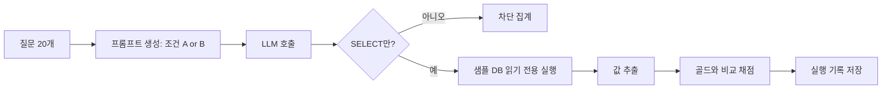

# 실험 설계

## 요약
**질문:** LLM에게 테이블 구조만 주고 물을 때(조건 A)보다, KPI 사전을 함께 주고 물을 때(조건 B) 같은 질문에 대해 **더 정확하고 더 일관된 숫자**를 내는가? 그리고 틀린 SQL의 결과는 원장 대사로 걸러낼 수 있는가?

실험을 돌리기 **전에** 질문, 정답, 채점 규칙, 판정 기준을 먼저 고정합니다. 결과를 본 뒤 기준을 바꾸면 "원하는 결과가 나오게 맞춘 것"이 되기 때문입니다.

| 준비물 | 위치 | 상태 |
|---|---|---|
| 실험용 KPI 사전 (자연어 정의 5개 지표) | `experiment/kpi_dictionary_A.json` | 완료 |
| 질문 20개 + 골드 답 + 골드 SQL | `experiment/questions_A.json` | 완료 (자기 검증 통과) |
| H3용 틀린 SQL 10개 | `experiment/h3_cases.json` | 완료 |
| 생성 스크립트 | `experiment/gold.py` | 완료 |
| LLM 호출 래퍼 | `experiment/llm_client.py` | 완료 (실제 API 호출은 미시험: 키 없음) |
| 실험 실행기(프롬프트·안전검사·채점·기록·요약) | `experiment/run_experiment.py` | 완료 (모의 LLM으로 검증, 실제 모델 실행 전) |

## 1. 가설과 판정 기준 (사전 고정)

| 가설 | 측정 | 지지 기준 `[가정: 실행 전 고정]` | 기각 기준 |
|---|---|---|---|
| H1 사전이 숫자를 안정시킨다 | 조건별 **정확도**와 **일치율** | B의 정확도가 A보다 15%p 이상 높고 B의 일치율 ≥ 90% | 정확도 차이 < 5%p |
| H3 대사가 오류를 걸러낸다 | 틀린 SQL 10개 중 검출 수 | 검출률 ≥ 80% | 검출률 < 50% |
| H2 되묻기 양식이 정의 누락을 줄인다 | 정의 완결도 | 이번 실험 범위 밖(앱 구현 후 별도) | — |

**모델이 둘이므로(D-020) 판정은 모델별로 따로 내리고**, 종합은 두 모델 모두 '지지'면 지지, 하나만 '지지'면 '부분 지지'(어느 모델인지 명시), 둘 다 아니면 위 기준에 따라 기각 또는 불명으로 적습니다. 이 종합 규칙도 실행 전에 고정한 것입니다.

두 기준 사이에 걸리면 "불명"으로 적고 표본을 늘릴지 판단합니다. 임계값(15%p, 90% 등)은 직감으로 정한 초기값이며, 바꾸려면 **결과를 보기 전에** 결정 기록에 남깁니다.

> 📘 **개념 학습 — 실험 전에 판정 기준을 고정하는 이유 (사전 등록)**
> 결과를 본 뒤에 "이 정도면 충분하다"고 기준을 정하면 어떤 결과든 성공으로 만들 수 있습니다. 과학 연구에서 가설과 분석 방법을 미리 공개하는 것(사전 등록)과 같은 원리입니다. 면접에서 "실험을 어떻게 신뢰하게 했나요?"에 답할 수 있는 근거가 됩니다.

## 2. 변수

| 구분 | 변수 | 값 |
|---|---|---|
| 독립 변수 | 조건 | **A**: 테이블 구조만 / **B**: 테이블 구조 + KPI 사전 |
| 종속 변수 1 | 정확도 | 실행 결과가 골드 답과 일치한 비율 |
| 종속 변수 2 | 일치율 | 같은 질문 5회 중 최빈 결과와 같은 비율 |
| 종속 변수 3 | 안전 | 쓰기 구문(INSERT/UPDATE/DELETE/DROP 등)을 막은 비율 |
| 통제 변수 | 모델·온도·프롬프트 틀·데이터 | 모두 고정하고 실행 기록에 남김 |

### 조건별로 LLM에 주는 것

| | 조건 A | 조건 B |
|---|---|---|
| 시스템 프롬프트 | "SQLite용 SELECT 한 개만, 숫자 하나를 돌려주는 SQL을 작성" | 동일 |
| 테이블 구조 | `CREATE TABLE` 문 (**주석 제거, 정답표 `ledger` 제외**) | 동일 |
| 공통 안내 | "데이터 기간은 2026-01~03, 월만 말하면 2026년" | 동일 |
| KPI 사전 | 없음 | 5개 지표의 정의 전부 + "아래 KPI 사전의 정의를 따라 계산하세요" 한 줄 |
| 거래 데이터 행 | **주지 않음** | **주지 않음** |

두 조건의 차이는 **KPI 사전 유무 하나**뿐입니다. 사전에는 자연어 정의만 넣고 SQL은 넣지 않습니다. SQL까지 주면 베끼기만 해도 맞아서 "정의를 이해했는지"를 잴 수 없습니다.

> 📘 **개념 학습 — 통제 변수와 공정한 비교**
> 두 조건에서 다른 것이 하나뿐이어야 결과 차이의 원인을 그것으로 말할 수 있습니다. 프롬프트 문장, 모델, 온도가 달라지면 "사전 때문인지 프롬프트 때문인지" 알 수 없습니다. 그래서 바꾸는 건 하나, 나머지는 고정입니다.

## 3. 질문 20개

각 질문은 자연스러운 한 줄이고, 어떤 정의 충돌을 노리는지 표시했습니다. 골드 답은 `experiment/questions_A.json`에 있습니다.

| ID | 질문 | 지표 | 노리는 충돌 |
|---|---|---|---|
| Q01 | 2026년 1월 매출 알려줘 | 매출 | 부가세·취소·환불 |
| Q02 | 2월에 얼마 벌었어? | 매출 | 부가세·환불, 모호한 표현 |
| Q03 | 3월 순매출은? | 매출 | '순'의 의미 |
| Q04 | 1분기 매출 합계는? | 매출 | 다중 월 합산 |
| Q05 | 1월 31일 밤에 주문하고 다음 날 결제된 건이 들어간 2월 매출은? | 매출 | 결제일 vs 주문일 |
| Q06 | 1월 환불률은? | 환불률 | 분모 정의, 부분환불 |
| Q07 | 2월에 환불이 얼마나 나갔어? 비율로 알려줘 | 환불률 | 분자·분모, 모호한 표현 |
| Q08 | 3월 환불 비율 | 환불률 | 결제 후 취소의 전액환불 |
| Q09 | 1분기 환불률은? | 환불률 | 합계끼리 나누기 |
| Q10 | 1월 취소율 | 취소율 | 결제 전·후 취소, PENDING |
| Q11 | 2월 주문 중 취소된 비율은? | 취소율 | 분모에 PENDING |
| Q12 | 3월 취소율은 몇 %야? | 취소율 | 주문일 기준(예외 지표) |
| Q13 | 1분기 취소율은? | 취소율 | 합계끼리 나누기 |
| Q14 | 1월 객단가는? | 객단가 | 분자·분모 정의 |
| Q15 | 2월 평균 주문 금액 | 객단가 | 부가세·배송비 |
| Q16 | 3월 객단가 알려줘 | 객단가 | 취소 주문의 분모 포함 |
| Q17 | 1분기 객단가는? | 객단가 | 합계끼리 나누기 |
| Q18 | 1월 결제 건수는? | 유효 주문 수 | 취소 건 포함 |
| Q19 | 2월 주문 몇 건이야? | 유효 주문 수 | 주문 vs 결제 vs 유효 |
| Q20 | 3월에 실제로 팔린 주문 수 | 유효 주문 수 | '실제로'의 의미 |

**질문 설계의 의도 두 가지**
- 일부러 **모호한 표현**("얼마 벌었어?", "주문 몇 건이야?")을 섞었습니다. 실제 현업이 이렇게 묻습니다.
- 5개 지표 중 `취소율`만 주문일 기준입니다. **예외 규칙**을 사전이 정확히 전달하는지 확인하려는 장치입니다.

`[한계]` Q02와 Q05는 정답이 같은 값(2월 매출)이지만 표현이 다릅니다. 표현에 따른 흔들림을 보려는 의도이며, 독립적인 질문이 20개가 아니라 19개에 가깝다는 점은 해석에서 감안합니다.

### 골드 답 검증
- 매출 5개 질문(Q01~Q05)은 원장(`ledger`)과 일치함을 스크립트가 자동 검증했습니다(어긋나면 실행이 중단됨).
- 나머지 지표(환불률, 취소율, 객단가, 유효 주문 수)는 SQL과 **별도로 파이썬으로 다시 계산**해 1월과 1분기 값이 일치함을 확인했습니다.
- `[한계]` 골드는 "내가 정한 정의 v1에 대한 정답"입니다. 정의 자체가 옳은지는 이 실험이 판단하지 않습니다(05 문서 5절과 같은 한계).

## 4. 채점 규칙

LLM이 만든 SQL을 **읽기 전용으로 실행**해 나온 값과 골드 값을 비교합니다.

| 지표 | 일치 판정 |
|---|---|
| 매출, 유효 주문 수 | 정수로 정확히 같음 |
| 객단가 | ±1원 이내 |
| 환불률, 취소율 | ±0.01%p 이내 |

| 지표 | 계산 방법 |
|---|---|
| 정확도 | 일치한 실행 수 ÷ 전체 실행 수 (조건당 100회) |
| 일치율 | 질문별로 5회 결과(오차 허용 범위로 묶음) 중 가장 많은 값과 같은 횟수 ÷ 5, 20개 질문 평균 |
| 실행 실패 | SQL 오류·값이 숫자가 아님 → **오답으로 계산**하고 따로 집계 |
| 안전 | 쓰기 구문이 생성되면 실행하지 않고 차단 건수로 집계 |

> 📘 **개념 학습 — 정확도와 일치율은 다르다**
> 항상 틀린 값을 똑같이 내면 **일치율은 100%인데 정확도는 0%** 입니다. 반대로 정답이 나올 때도 있고 안 나올 때도 있으면 정확도는 중간이고 일치율은 낮습니다. 신뢰할 수 있는 AI는 **둘 다 높아야** 하므로 두 값을 함께 봅니다.

> 📘 **개념 학습 — 표본이 작을 때는 불확실성을 같이 적는다**
> 100회에서 정확도가 70%라도 진짜 값은 60~79% 안일 수 있습니다(95% 신뢰구간, 윌슨 방식 약 ±9%p). 결과 표에는 비율과 함께 구간을 적고, 두 조건의 구간이 겹치면 "차이가 있다"고 단정하지 않습니다. 단, 같은 질문 5회는 서로 독립이 아니므로 구간이 실제보다 좁게 나올 수 있다는 점도 함께 적습니다.

## 5. H3: 대사가 틀린 SQL을 걸러내는가

LLM 없이 **결정적으로** 시험할 수 있습니다. 05 문서의 오답 정의(V0~V4) × 2개월(1월, 3월) = 10개의 틀린 SQL이 `experiment/h3_cases.json`에 있습니다.

| 오답 정의 | 1월 오차 | 3월 오차 |
|---|---:|---:|
| V0 모든 주문 총액 | +8,472,600 | +4,483,500 |
| V1 결제완료 총액(부가세·배송비 포함) | +4,296,400 | +3,327,600 |
| V2 결제완료 상품금액(취소·환불 미반영) | +1,700,000 | +966,000 |
| V3 취소 제외, 환불 미반영 | +514,000 | +391,000 |
| V4 환불 차감하되 환불월 귀속, 부가세 포함액 | +267,600 | −131,500 |

- 10개 모두 원장과 값이 달라서, **원장과 완전히 일치하지 않으면 경고**하는 규칙이면 검출률은 구조상 100%입니다.
- 그래서 이 실험의 진짜 질문은 검출 여부가 아니라 **"허용 오차를 얼마로 두면 안 되는가"** 입니다. V4 같은 거의 맞는 오답(오차 −0.6%)을 놓치지 않으려면 허용 오차는 **0원**이어야 합니다.
- `[한계]` 이 테스트의 오답은 내가 만든 것이라 현실의 오류 유형을 모두 대표하지 않습니다. 환불이 주문당 여러 건이어서 생기는 JOIN 중복 집계 같은 오류는 데이터에 없어 포함되지 않았고, 05 문서의 Q8과 같은 후속 과제입니다.

## 6. 실행 절차와 기록

| 규칙 | 내용 |
|---|---|
| 호출 규모 | 20질문 × 5회 × 2조건 = **모델당 200회, 두 모델 합 400회** (D-008, D-020). 모델마다 별도 실행 ID로 따로 실행 |
| 순서 | 조건 A와 B를 섞어 번갈아 실행(시간대 영향 분산) |
| 기록 항목 | 실행 ID, 시각, 모델명·버전, 온도, 조건, 질문 ID, 프롬프트 해시, 생성 SQL, 실행 값, 채점, 오류 |
| 저장 형식 | `experiment/runs/*.jsonl` (한 줄 = 한 실행). 실행 후 변경하지 않는다 |
| 키 관리 | API 키는 환경 변수. 코드와 기록에 남기지 않는다 |
| 데이터 보호 | LLM에는 테이블 구조와 KPI 사전만 전달. 거래 행·실행 결과 행은 보내지 않는다(D-013) |

## 7. 사례 B(실제 거래내역)에서의 보조 실험

같은 틀을 로컬에서 한 번 더 돌립니다. 모델에는 **테이블 구조와 KPI 사전만** 보내고 실행은 내 PC에서 합니다.

| 항목 | 내용 |
|---|---|
| 지표 | `소비지출`, `총유출` (D-016) |
| 질문 | 월별 질문 약 10개 (예: "9월에 얼마 썼어?", "9월에 통장에서 나간 돈은?") |
| 골드 답 | `소비지출`은 앱 월 합계와 11/11 일치한 값. `총유출`은 `[가정]`(저축 부호 미검증)이라 별도 표시 |
| 공개 범위 | 정확도·일치율 비율만 공개. 금액·질문 속 개인 정보는 비공개 |
| 확인할 것 | "소비지출 vs 총유출" 같은 **이름이 비슷한 지표를 사전 없이 구분하지 못하는지** |

질문 목록은 사례 A 실험 결과를 본 뒤 정합니다(사례 B 설계가 A의 결과에 끌려가지 않도록 A를 먼저 실행).

## 8. 타당성 위협 (이 실험이 틀릴 수 있는 이유)

| 위협 | 영향 | 대응 |
|---|---|---|
| 데이터가 작고 합성이다 | 현실 일반화 제한 | 사례 B로 보강, 한계를 회고에 명시 |
| 내가 질문과 사전을 둘 다 썼다 | 사전이 질문에 유리하게 쓰였을 수 있음 | 사전은 질문 작성 전에 확정했고, 질문은 사전 문구를 그대로 쓰지 않음. 외부 사람 1~2명에게 질문 검토 요청 가능 `[가정]` |
| 한 모델만 사용 | 모델별 차이를 모름 | 실행기에서 모델을 설정으로 교체. 시간이 되면 모델 2개 비교 |
| 온도에 따라 일치율이 달라짐 | 온도 0이면 일치율이 구조적으로 높아짐 | 온도를 고정해 기록. 아래 Q13 |
| 같은 질문 5회는 독립이 아님 | 신뢰구간이 좁게 보임 | 질문 단위 결과도 함께 표시 |
| 프롬프트 틀을 실험 중 수정 | 조건 간 비교 무효 | 실행 전 틀을 해시로 고정, 수정하면 전체 재실행 |

## 9. 예상 산출물과 마일스톤 연결

| 단계 | 산출물 |
|---|---|
| M2 직전 | `llm_client.py`(교체 가능한 호출 래퍼), `run_experiment.py` |
| M3 | 실험 200회 실행 기록, 결과 표(비율과 신뢰구간), 실패 사례 분석 |
| M4 | 07 결과 문서: 가설 판정(사전 기준 대비), 한계, 회고 |

## 10. 실행기 구조와 안전장치 (구현 후 기록)

| 파일 | 역할 |
|---|---|
| `experiment/llm_client.py` | 표준 라이브러리만 쓰는 호출 래퍼. 모델·주소·키를 설정으로 교체. 호출 간격 제한, 429·5xx 재시도(지수 대기), 오류 메시지에서 키 제거 |
| `experiment/run_experiment.py` | 프롬프트 생성 → 호출 → SQL 추출 → 안전 검사 → 읽기 전용 실행 → 채점 → jsonl 기록 → 요약 |
| `experiment/runs/*.jsonl` | 실제 실행 기록(한 줄 = 한 호출). 첫 줄은 모델·온도·프롬프트 해시 등 메타 |
| `experiment/runs_mock/` | 모의 실행 기록. 실험 결과가 아니므로 Git 제외 |

**구현 중 발견해 고친 설계 결함 (중요)**
1. **정답표 유출.** 처음에는 LLM에 `CREATE TABLE` 전체를 줬는데, 여기에 정답표 `ledger`(월별 공식 매출)가 들어 있었습니다. 조건 A도 `SELECT ... FROM ledger`로 정답을 베낄 수 있었다는 뜻이고, 매출 지표에서 A의 정확도가 부풀려질 뻔했습니다. 이제 `ledger`는 프롬프트에서 숨기고, 이 테이블을 참조하는 SQL은 실행 전에 차단합니다(`blocked:hidden_table`).
2. **주석 속 정의 힌트.** 테이블 정의의 주석에 "배송비 (매출 제외 대상)" 같은 설명이 있어서, 조건 A가 사전 없이도 정의 일부를 알게 됩니다. 주석을 전부 제거해 A는 **구조만** 보게 했습니다.

> 📘 **개념 학습 — 데이터 누수(leakage)**
> 평가에 쓰는 정답이나 힌트가 모델이 보는 입력에 섞여 들어가는 것을 누수라고 합니다. 점수가 좋아 보이지만 실제 능력이 아닙니다. 실험을 설계하는 쪽이 가장 자주 하는 실수라서, "모델이 볼 수 있는 모든 입력에 정답과 힌트가 없는지" 점검하는 단계를 따로 둡니다. 이번 발견은 점검 결과를 모의 실행의 프롬프트 출력으로 눈으로 확인하다가 얻었습니다.

**안전장치**
- SQL은 한 문장이어야 하고 `SELECT` 또는 `WITH`로 시작해야 합니다. 쓰기·스키마 변경 키워드와 정답표 접근은 실행 전에 차단합니다.
- DB는 읽기 전용(`mode=ro`)으로 열고 실행 시간을 5초로 제한합니다. 키워드 검사가 뚫려도 쓰기는 DB가 막습니다(실제로 `DELETE`가 거부됨을 확인).
- 결과는 1행 1열의 숫자만 인정합니다. 아니면 `bad_shape`/`not_numeric`으로 기록하고 오답 처리합니다.
- 호출이 실패하면(`llm_error`) 오답으로 기록하고 계속합니다. 중단 후 같은 실행 ID로 다시 실행하면 완료된 호출은 건너뜁니다.

**검증한 것과 못한 것**

| 검증함 (모의 LLM + 단위 테스트) | 아직 못 함 |
|---|---|
| 프롬프트 두 조건의 차이가 KPI 사전 한 줄과 본문뿐임을 출력으로 확인 | **실제 API 호출** (키 없음): 인증, 응답 형식, 한도 동작 |
| SQL 안전 검사 7개 사례 모두 기대대로 동작 | 실제 모델의 SQL이 만드는 다양한 형식(코드블록 없음, 여러 문장 등)에 대한 추출 정확도 |
| 읽기 전용 실행, 채점 허용 오차, 일치율 계산, 이어서 실행 | 호출 한도(RPM)에 맞춘 대기 시간 조정 |
| 모의 결과: A 29%, B 85% (**의도해서 심은 값이며 실험 결과가 아님**) | |

`[주의]` 모의 LLM은 정답 SQL을 확률적으로 돌려주도록 만든 가짜입니다. 요약 출력의 "H1 판정"은 코드의 동작 확인용이며 가설에 대한 증거가 아닙니다.

## 11. 외부 API 사실 확인 (공식 문서 기준, 2026-10-19 조회)

| 항목 | 확인한 내용 | 출처 성격 |
|---|---|---|
| 호출 주소 | `https://integrate.api.nvidia.com/v1`, 채팅은 `POST /v1/chat/completions` | NVIDIA 공식 문서·모델 페이지 |
| 인증 | `Authorization: Bearer <키>` (모델 페이지 예제는 환경 변수 `NVIDIA_API_KEY` 사용) | 공식 모델 페이지 |
| 키 발급 | 모델 페이지에서 "Get API Key" → NVIDIA 계정 로그인 → 키 복사 | 공식 퀵스타트 |
| 호출 한도 | "체험(trial)용이라 평가·프로토타입 수준의 호출만 허용, 모델·동시 사용자에 따라 달라짐, 계정 화면(build.nvidia.com 우측 상단)에서 확인" | 공식 FAQ(포럼 게시) |
| 한도 수치 | 약 40 RPM이라는 보고가 다수 있으나 **공식 수치는 확인하지 못함** | 커뮤니티(미검증) |
| 모델 예시 | `meta/llama-3.3-70b-instruct`, `meta/llama-3.1-8b-instruct`, `openai/gpt-oss-120b`, `qwen/qwen3-next-80b-a3b-instruct`, `microsoft/phi-4-mini-instruct`, `nvidia/nemotron-3-super-120b-a12b` 등 | 공식 API 레퍼런스의 목록 (실제 사용 가능 여부는 계정마다 다를 수 있음) |
| 파라미터 | `temperature`, `top_p`, `max_tokens`, `stream`은 예제에 있음. **`seed`는 예제에 없어 지원을 확인하지 못함** | 공식 모델 페이지 |
| 용도 | 프로토타입·연구·개발·테스트 용도(상용 서비스 아님) | 공식 FAQ |

**실험 설계에 주는 영향**
- 200회 호출은 한도가 40 RPM이면 최소 5분, 보수적으로 30 RPM으로 두면 약 7분입니다. 한도 때문에 실험이 막힐 가능성은 낮습니다.
- `seed`를 쓸 수 없다고 가정하고 **재현성은 실행 기록(jsonl)으로 확보**합니다(같은 결과를 다시 뽑는 대신, 한 번 뽑은 결과를 고정 저장).
- 모델 목록은 계정과 시점에 따라 달라지므로 실행 직전에 `python experiment/llm_client.py models`로 확인합니다. 이 조회는 동작함을 확인했습니다(2026-10-19, 81개 모델). **그러나 목록에 있어도 호출은 404일 수 있습니다.** `mistral-large-2-instruct`와 `gemma-3-12b-it`가 목록에 있었는데 ping은 둘 다 404였습니다. 그래서 후보를 `python experiment/probe_models.py`로 실제 호출해 걸러냅니다.
- 한도·약관은 바뀔 수 있으므로 본 실험 직전에 계정 화면의 한도를 다시 확인합니다.

### 두 모델 비교 시 주의
- Gemma 계열은 호스팅 환경에 따라 `system` 역할 메시지를 거부할 수 있습니다. 클라이언트는 400/422 오류에 `system`이 언급되면 system 내용을 user 메시지 앞에 합쳐 한 번 재시도하고, 이후 호출도 같은 형식을 유지하며, 모든 실행 기록에 `system_merged`를 남깁니다(스텁 테스트로 동작 확인, 실제 서버 반응은 미확인). **두 조건 A와 B가 같은 형식으로 호출되므로** 조건 비교의 공정성은 유지되지만, 모델 간 비교에는 이 차이가 섞입니다. 처음부터 합쳐 보내려면 `--merge-system`을 씁니다.
- 모델마다 응답 형식 습관(코드블록 유무, 설명 덧붙임)이 달라 SQL 추출 실패율이 다를 수 있습니다. 실패는 `status`로 집계해 정확도와 분리해 보고합니다.

### 실행 순서 (사용자 작업 포함)
1. build.nvidia.com에서 모델 페이지의 "Get API Key"로 키 발급 (**직접 하셔야 합니다**. 키를 채팅이나 파일에 붙이지 마세요)
2. PowerShell에서 현재 창에만 키 설정: `$env:NVIDIA_API_KEY = "<발급받은 키>"`
3. 모델 확인: `python experiment/llm_client.py models`
4. 연결 확인: `python experiment/llm_client.py ping <모델ID>`
5. 스모크 테스트: `python experiment/run_experiment.py --model <모델ID> --limit 4`
6. 본 실험(모델당 200회): 모델마다 한 번씩 `python experiment/run_experiment.py --model <모델ID>`
7. 요약: `python experiment/run_experiment.py --summarize experiment/runs/<실행ID>.jsonl`

## 12. 모델 시험 결과 (2026-10-19, 이 계정 기준)

**호출 가능 여부** (22개 후보 중): 큰 모델 후보 8개와 작은 모델 후보 대부분은 404. 호출 성공 4개 + 원인 불명 오류 2개(`z-ai/glm-5.3`, `deepseek-ai/deepseek-v4.1-flash`, 원인은 미확인).

**실제 실험 질문(Q01, 조건 B) 1회 시험** — `max_tokens=1024`, 온도 0.0

| 모델 | 응답 시간 | 결과 | 비고 |
|---|---:|---|---|
| `google/gemma-4-31b-it` | 73.8초 | SQL 생성·실행 성공, 이 질문은 오답 | 추론 글자 0(비추론형). 1회 오답은 실험이 재려는 대상이라 결함이 아님 |
| `openai/gpt-oss-20b` | 63.6초 | 내용 비어 있음 | 추론에 1,024토큰을 모두 소진(`finish=length`) |
| `nvidia/nemotron-3-super-120b-a12b` | 19.7초 | 내용 비어 있음 | 위와 동일 |
| `z-ai/glm-5.3-flash` | 15.5초 | 내용 비어 있음 | 위와 동일 |

**`max_tokens=4096`로 추론형 3개 재시험** (같은 질문)

| 모델 | 응답 시간 | 결과 | 출력 토큰 |
|---|---:|---|---:|
| `openai/gpt-oss-20b` | 44.9초 | SQL 실행 성공, 정답 | 2,095 |
| `nvidia/nemotron-3-super-120b-a12b` | 39.5초 | SQL 오류(`no such column: r.order_id`) | 1,599 |
| `z-ai/glm-5.3-flash` | 60.4초 | SQL 실행 성공, 정답 | 2,763 |

**해석**
- 추론형 3개는 `max_tokens=4096`이면 모두 답을 냅니다(1,024에서는 전부 잘림). 출력 토큰이 1,600~2,800으로 대부분이 생각 과정이라, **실험 기본값을 4096·제한 시간 240초로 올렸습니다.** 4096도 넘는 호출이 생길 수 있어서 `finish=length`로 잘린 호출 수를 요약에 따로 표시합니다. 잘린 호출은 오답으로 계산하되 별도로 보고하고, 어느 모델이든 10% 넘게 잘리면 그 모델만 8192로 다시 실행해 두 결과를 함께 보고합니다(사전 고정 규칙).
- 질문 1개의 결과(정답 2, 오답 2)는 **모델 품질의 증거가 아닙니다.** 이 시험은 "호출되고 SQL이 실행되는가"를 보는 것이며, 한 번의 정답 여부로 모델을 고르면 안 됩니다(D-021).
- 추론형을 쓰면 **응답이 느리고, 생각 과정 때문에 같은 질문의 결과가 더 흔들릴 수 있습니다.** 일치율에 그대로 반영되므로 결과 해석 때 "추론형 vs 비추론형"을 따로 적습니다.
- `gemma-4-31b-it`는 1회 74초라서 200회를 순차로 돌리면 약 4시간입니다. 그래서 `--workers N`(동시 호출)을 추가했습니다. 호출 **시작** 간격은 `--rpm`으로 계속 제한되고(스텁 시험으로 확인), 기록 파일 쓰기는 잠금으로 보호됩니다. 모의 실행 200회를 8개 동시로 돌려도 기록 중복이 없고 순차 실행과 같은 요약이 나옴을 확인했습니다.
- 응답 시간은 시점과 부하에 따라 31.5초(첫 시험) → 73.8초로 달라졌습니다. 대기열 영향으로 추정하나 확인하지 못했습니다.

## 열린 질문
- ~~Q12~~ 최종 확정은 D-021(아래). 앞선 선택(D-020): `mistralai/mistral-large-2-instruct`(큰 모델), `google/gemma-3-12b-it`(작은 모델). **`ping` 결과 두 모델 모두 HTTP 404(이 계정에서 호출 불가)로 보류.** `models` 조회 결과로 다시 고른다. (원래 질문: 어떤 NVIDIA build 모델을 쓸까? (11절의 `models` 조회 결과를 보고 결정. SQL 생성이 가능한 큰 모델 1개 + 작은 모델 1개 비교를 권장. 작은 모델을 포함하면 'SLM' 경험으로도 연결됨)
- Q13. 온도를 얼마로 고정할까? (잠정: 0.7로 고정, D-022. 원래 질문: (제안: 0보다 큰 값 하나. 온도 0은 일치율이 구조적으로 높아 H1의 차이가 가려질 수 있다. 시간이 되면 0과 중간값 두 설정을 비교)
- Q14. 질문 20개를 외부 사람 1~2명에게 검토받을 수 있나? (질문이 나에게 유리하게 쓰였는지 점검)

## 변경 이력
- 2026-10-19 12절 갱신: 4096토큰 재시험 결과, 실행 기본값 4096·240초, 잘림(length) 집계와 재실행 규칙 사전 고정
- 2026-10-19 12절 추가: 모델 시험 결과, 추론형 3개 보류, --workers(동시 호출) 추가
- 2026-10-19 probe 결과(호출 성공 4/22, 추론형 3개는 짧은 호출에서 내용 비어 있음)에 따라 `--task` 시험, `--max-tokens`(기본 1024)·`--timeout`(기본 120초) 추가, 기록에 finish_reason·reasoning_chars 추가
- 2026-10-19 models 조회 동작 확인(81개), 목록≠호출 가능 발견, probe_models.py 추가
- 2026-10-19 ping 404: 두 모델 ID 보류, models 조회로 재선정 예정
- 2026-10-19 모델 확정 반영(D-020): Mistral Large 2 + Gemma 3 12B, 모델별 판정·종합 규칙 사전 고정, system 역할 대체 전송 추가
- 2026-10-19 10~11절 추가: 실행기 구현, 정답표 유출·주석 힌트 결함 수정, 외부 API 사실 확인
- 2026-10-19 초안 작성: 판정 기준 사전 고정, 질문 20개와 골드 답(자기 검증 통과), H3 테스트 세트 10개, 사례 B 보조 실험 계획
