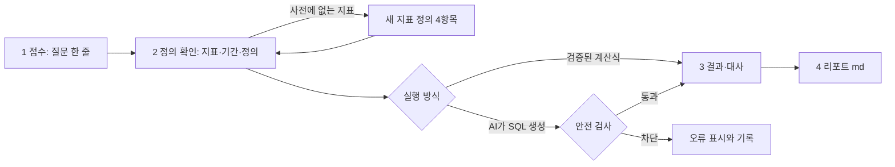
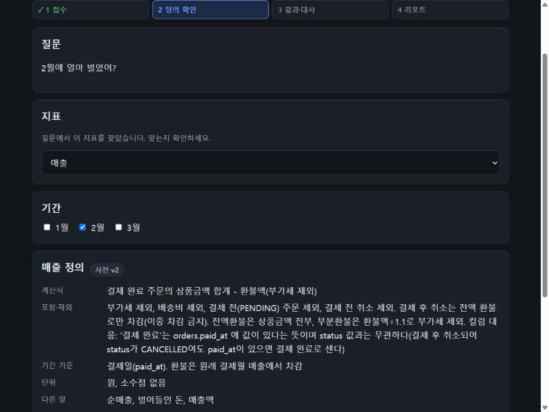
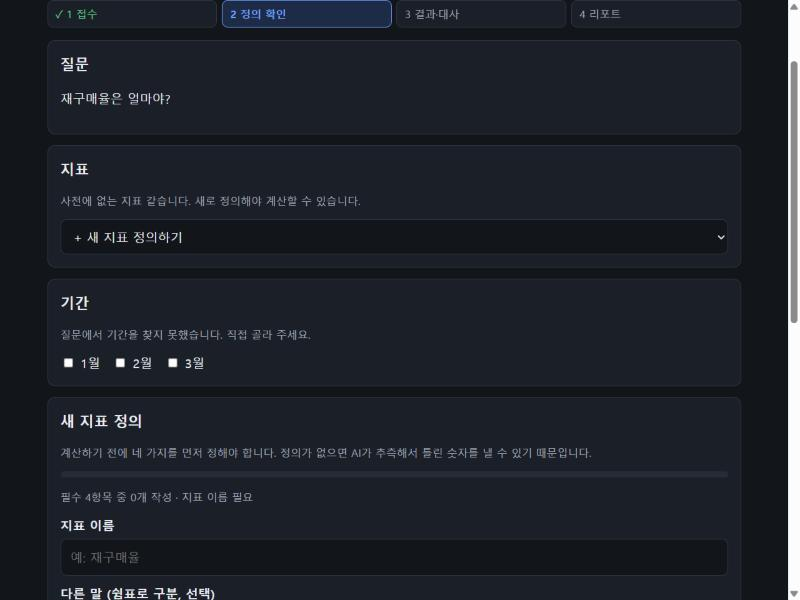
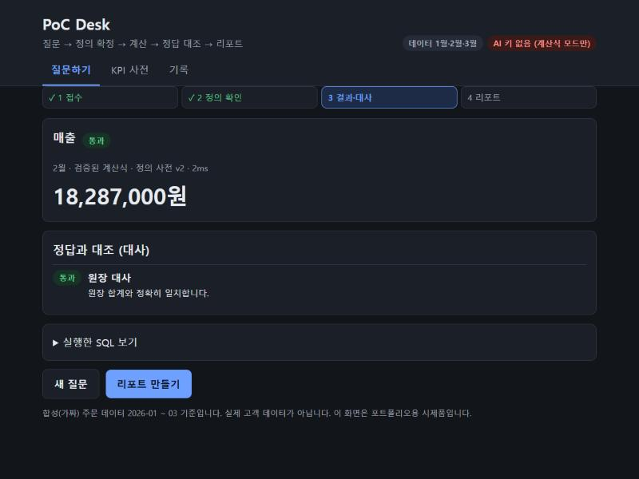
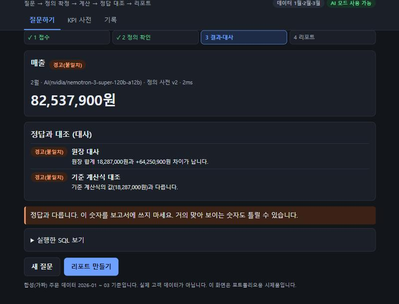
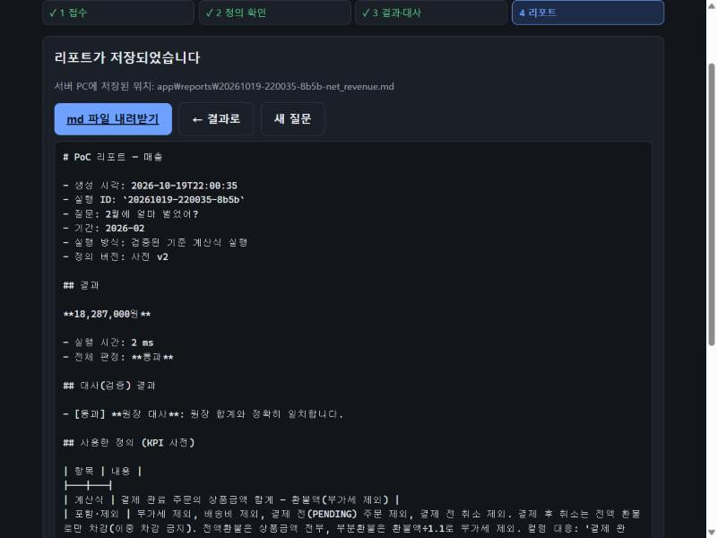
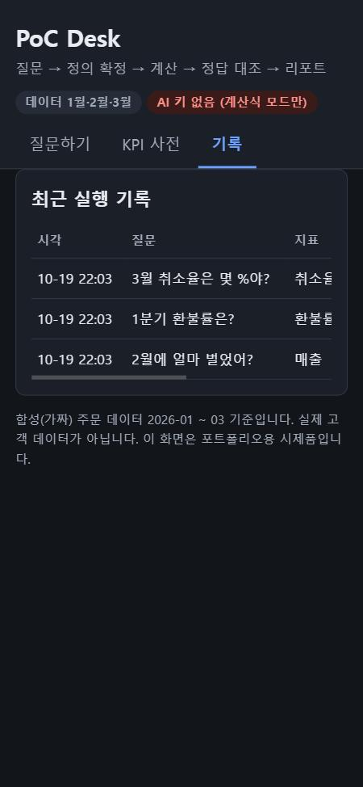

# PoC Desk 앱

## 요약
[04 문서](04-journey-and-flow.md)에서 설계한 크리티컬 여정(질문 → 정의 확인 → 계산 → 정답 대조 → 리포트)을 **실제로 눌러 볼 수 있게** 만든 로컬 웹앱 시제품입니다. 추가 설치 없이 Python만으로 실행되고, 합성 데이터에서만 동작합니다.

**이 앱이 보여 주는 것:** 정의가 확정되지 않은 지표는 계산하지 않고, 정답 출처가 없는 숫자에는 "검증됨"을 붙이지 않으며, 틀린 숫자는 경고한다는 실험 결과(07, 09)의 설계 원칙입니다.

**솔직한 상태:** 계산식 모드와 대사, 리포트, 사전, 기록은 테스트와 브라우저로 확인했습니다. **AI 모드는 가짜 LLM으로만 확인했고, 실제 모델로 앱에서 호출해 본 적은 없습니다**(이 환경에 API 키가 없었음).

## 1. 실행 방법
```powershell
cd C:\realDefinition
python app/server.py
```
브라우저가 `http://127.0.0.1:8765`로 자동으로 열립니다. 끄려면 PowerShell 창에서 `Ctrl + C`.

AI 모드까지 쓰려면 **서버를 시작하는 창에서** 키를 먼저 설정합니다(키를 채팅이나 파일에 붙이지 마세요).
```powershell
$s = Read-Host "NVIDIA API key" -AsSecureString
```
```powershell
$env:NVIDIA_API_KEY = (New-Object System.Net.NetworkCredential("", $s)).Password
```
테스트: `python app/test_app.py` (20개, 약 1초)

## 2. 화면과 흐름



| 화면 | 하는 일 | 스크린샷 |
|---|---|---|
| 1 접수 | 질문 입력, 예시 질문 | |
| 2 정의 확인 | 지표·기간 해석 결과 확인, 정의 4항목 보기, **확정 체크** 후에만 실행 |  |
| 2 새 지표 정의 | 사전에 없는 지표는 **필수 4항목을 채워야** 저장·실행 가능 (진행률 표시) |  |
| 3 결과·대사 (통과) | 값, 실행 시간, 원장 대사 결과, 실행한 SQL |  |
| 3 결과·대사 (경고) | 정답과 다르면 경고와 차이를 보여 주고 보고서에 쓰지 말라고 안내 |  |
| 4 리포트 | 마크다운 리포트 미리보기·저장·내려받기 |  |
| KPI 사전 | 지표별 정의와 버전 | |
| 기록 | 최근 실행 기록과 판정 (휴대폰에서는 표가 카드 안에서 스크롤) |  |

스크린샷은 개발 중 캡처한 것이라 세부 문구가 최종본과 조금 다를 수 있습니다.

## 3. PRD 대응 ([03 문서](03-prd.md))

| 기능 | 상태 | 구현 내용과 한계 |
|---|---|---|
| F1 요구 접수 | ✅ | 한 줄 입력. 지표·기간은 **규칙 기반 키워드 해석**(LLM 아님). 표현이 다양하면 못 찾을 수 있어 사용자가 직접 고르게 함 |
| F2 모호성 되묻기 | ✅ | 사전에 없는 지표는 고정 양식 4항목(계산식, 포함·제외, 기간 기준, 단위)이 다 채워져야 저장. 기존 지표는 정의를 보여 주고 확정 체크를 요구. 보조 질문(LLM 생성)은 미구현 |
| F3 KPI 사전 저장·조회·버전 | ✅ | 사용자 정의 지표는 수정하면 버전이 오르고 이전 버전이 남음. 내장 5개는 읽기 전용 |
| F4 정의 기반 SQL 생성 | ◐ | AI 모드는 테이블 구조와 사전만 모델에 보냄(거래 행 없음). **사전에 없는 지표는 실행 거부**. 실제 모델 호출은 앱에서 미검증 |
| F5 실행·결과 표시 | ✅ | 읽기 전용 실행, 실행 시간 표시. 결과는 숫자 하나(1행 1열)만 지원 |
| F6 대사 | ✅ | 매출: 원장과 정확히 일치(허용 오차 0). AI 모드: 기준 계산식과도 대조. 정답 출처가 없는 지표: **"검증 불가"** 로 표시 |
| F7 리포트 | ✅ | 질문, 정의 버전, SQL, 결과, 대사, 한계를 담은 md |
| F8 일치율 실험기 | ✗ | `experiment/` 스크립트가 대신함 (앱 화면에는 없음) |
| F9 실패 기록 | ◐ | 모든 실행(성공, 경고, 오류, 차단)이 기록 탭에 남음. 원인을 적는 입력은 없음 |
| F10 로그인·역할 | ✗ | 범위 밖 (내 PC에서만 접속) |

## 4. 설계 결정

**D-029 설치가 필요 없는 로컬 웹앱으로 만든다.** Python 표준 라이브러리 서버와 순수 HTML·CSS·JS입니다. 이유: 채용 담당자가 `python app/server.py` 한 줄로 실행할 수 있고, 외부 패키지가 없어 의존성 위험도 없습니다. 버린 대안은 Streamlit(설치 필요, 코드는 짧음), Flask(설치 필요), Electron(과함)입니다. 비용: 화면 코드를 직접 작성해야 해서 길어집니다.

**D-030 두 실행 방식을 모두 제공하고 "검증됨"의 조건을 엄격히 한다.**
- *검증된 계산식 모드*: 사람이 검토한 SQL을 실행합니다. 07·09 문서에서 오답이 모델의 체계적 습관이라는 것을 확인했고, 그래서 시맨틱 레이어 방식(LLM이 SQL을 새로 짜지 않음)이 근본 해법일 수 있다고 본 가설의 **시제품**입니다. 이 방식은 아직 실험으로 평가하지 않았습니다.
- *AI 모드*: LLM이 SQL을 만들고 기준값과 원장에 대조합니다.
- 정답 출처가 없는 지표는 어떤 방식이든 **"검증 불가"** 로 표시합니다(D-025).

## 5. 보안 설계
- **내 PC에서만 접속**(127.0.0.1에만 바인딩). 다른 웹사이트가 이 서버로 요청을 보내는 것을 막기 위해 Host·Origin 검사, JSON 요청만 허용, 사용자 지정 헤더 확인을 합니다.
- **API 키는 환경 변수**로만 읽고 화면·응답·기록으로 나가지 않습니다(키가 있는지 여부만 표시).
- **AI에는 테이블 구조와 사전만** 보냅니다. 거래 행도, 정답표(`ledger`)도 보내지 않습니다.
- LLM이 만든 SQL은 **읽기 전용 한 문장**만 실행합니다. 쓰기·변경 키워드, 여러 문장, 정답표 접근은 실행 전에 차단합니다.
- 화면의 모든 문자열은 DOM API(텍스트 노드)로만 넣어 스크립트가 실행될 틈을 막고, 콘텐츠 보안 정책(CSP)으로 외부 스크립트를 차단합니다.

## 6. 검증한 것과 못한 것

| 검증함 | 방법 |
|---|---|
| 질문 20개의 계산 결과가 골드와 일치, 매출은 원장과 정확히 일치 | `app/test_app.py` |
| 기간·지표 해석, 사전 4항목 필수와 버전, 사전에 없는 지표 실행 거부 | 단위 테스트 |
| AI 모드의 통과·경고·차단·검증 불가·키 없음 처리, 프롬프트에 정답표가 없음 | 가짜 LLM 테스트 |
| 서버 보안(외부 Host·Origin 거부, 형식·크기 제한, 경로 탈출 차단, 키 비노출) | HTTP 테스트 |
| 화면 흐름 전체(통과, 경고, 차단, 새 지표 정의 폼, 리포트, 기록, 휴대폰 폭) | 브라우저에서 직접 조작. 콘솔 오류 없음 |

| 못한 것 | 이유·영향 |
|---|---|
| **실제 LLM을 앱에서 호출** | 이 환경에 키가 없음. 가짜 LLM으로 경로만 확인함 |
| 스크린 리더, 다른 브라우저, 큰 글씨 시험 | 레이블·키보드 조작·대비는 고려해 만들었으나 도구로 점검하지 않음 |
| 여러 사람이 동시에 사용 | 범위 밖 |

## 7. 한계
- 합성 데이터 3개월에서만 동작하며 실제 고객 데이터 연동이 없습니다.
- 질문 해석이 키워드 규칙이라 새 표현에 약합니다.
- 계산식 모드는 내장 5개 지표만 지원하고, 새로 정의한 지표는 AI 모드로만 계산되며 항상 "검증 불가"입니다.
- 결과는 숫자 하나만 지원합니다(표, 그래프 없음).

## 8. 다음 단계
1. 실제 모델로 AI 모드를 한 번 돌려 보고 결과 기록하기 (키 필요)
2. 질문과 **관련된 지표 정의만** 모델에 전달(v3), 번짐 가설 확인 ([09 문서](09-experiment-v2-results.md))
3. 계산식 모드를 실험으로 평가하기 (시맨틱 레이어 가설)

## 열린 질문
- Q27. 계산식 모드를 "검증됨"이라고 불러도 될까? 현재는 사람이 검토한 SQL이라는 의미로 "기준 계산식"이라고만 표시한다. (제안: 평가 전까지 그대로 둔다)

## 변경 이력
- 2026-10-19 초안 작성: 앱 구현, 테스트 20개, 브라우저 확인, PRD 대응표, 설계 결정 D-029, D-030
