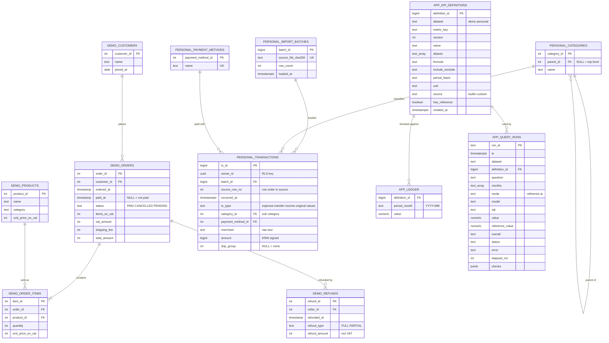
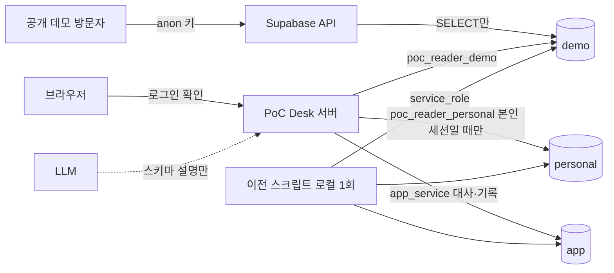

# Supabase DB 기획과 ERD

## 요약
로컬 SQLite 두 개(합성 주문 DB, 실제 가계부 DB)를 Supabase(Postgres)로 옮기기 위한 **기획서**입니다. 인터뷰(13개 질문, 3라운드)로 정한 결정을 표와 ERD로 고정했고, **실제 이전(마이그레이션)은 하지 않았습니다.** 이 문서가 확정되면 다음 단계(스펙 → 작업 티켓 → 구현)로 갑니다.

핵심 결정 세 줄:
1. **3개 스키마로 분리**: `demo`(합성, 공개 읽기) / `personal`(가계부, 본인만) / `app`(지표 정의·원장·실행 기록).
2. **가계부는 API에 노출하지 않는다.** 앱 서버만 읽기 전용 DB 역할로 직접 접속한다.
3. **원본 행은 지우지 않는다.** 중복 의심은 표시만 하고, 합성 데이터는 값을 한 글자도 바꾸지 않는다.

> 📘 **개념 학습 — Supabase, Postgres, 스키마, RLS**
> - **Postgres**: SQLite와 같은 관계형 DB이지만 서버로 돌고, 여러 사용자·권한을 구분할 수 있다.
> - **Supabase**: Postgres에 로그인(Auth)과 자동 API(PostgREST)를 붙여 호스팅해 주는 서비스. DB 자체는 일반 Postgres다.
> - **스키마**: 한 DB 안의 "폴더". 같은 이름의 테이블도 폴더가 다르면 따로 존재하고, 폴더 단위로 권한을 줄 수 있다.
> - **RLS(Row Level Security)**: 테이블 안에서 "이 행은 이 사용자만 읽는다"를 DB가 강제하는 규칙. 앱 코드가 실수해도 DB가 막는다.
> - **role(역할)**: DB 접속 계정. 역할마다 읽을 수 있는 스키마·테이블이 다르다.

## 1. 범위와 비범위
| 구분 | 내용 |
|---|---|
| 범위 | 이전 대상 선정, 스키마·테이블·키·관계(ERD), 접근 경로, 권한, 이전 원칙, 비밀 보관 원칙 |
| 비범위 | 실제 이전 실행, Supabase 프로젝트 생성, 앱 코드의 Postgres 전환, 가맹점 정규화, 리포트 파일(`app/reports`)의 DB 저장 |

## 2. 현재 상태 (2026-10-20 조회)
| | 합성 데이터셋 | 가계부 데이터셋 |
|---|---|---|
| 위치 | `data/poc_desk_sample.db` | `data/private/bank.db`(git 제외) |
| 규모 | 고객 15, 상품 8, 주문 500, 항목 1,017, 환불 52, 원장 3 | 거래 1,770행 (2025-10-19 ~ 2026-10-19) |
| 구조 | 6테이블 | 1테이블 `tx` (날짜·시간 TEXT, 금액 정수, 지출은 음수) |
| 값 분포 | — | 타입 3종, 대분류 29, 소분류 53, 가맹점 347, 결제수단 17, 널 값 없음 |
| 알려진 문제 | 월말 경계 조건(1/28 포함) — 고치지 않음(D-032) | 완전 동일 행 26묶음, 금액 0원 25건 |
| 정의 파일 | `experiment/kpi_dictionary_A_v2.json`(내장 5개) | 사용자 정의는 `app/data/custom_kpis.json`, 실행 기록은 `history.jsonl` |

## 3. 인터뷰에서 정한 결정 (Q1~Q13)
| # | 질문 | 결정 |
|---|---|---|
| Q1 | 이전 대상 | 둘 다 설계. 가계부는 본인 전용, 공개 저장소에는 합성 데이터만 |
| Q2 | 앱 동작 방식 | 앱 서버가 읽기 전용 role로 Postgres에 접속. LLM은 스키마만 받고 거래 행은 못 받음 |
| Q3 | 사용자 | 본인 1계정 + 합성 데이터 공개 읽기 데모 |
| Q4 | 지표 정의·원장 | DB 테이블로 이전. 버전 이력은 쌓기만 하고 지우지 않음 |
| Q5 | 중복 의심 26묶음 | 원본 행 전부 보존, `dup_group`으로 표시만 |
| Q6 | 스키마 | `demo` / `personal` / `app` 3분리 |
| Q7 | 금액·시각 | 정수 원 + 부호 유지, `occurred_at`(timestamptz, 한국시간 해석) |
| Q8 | 정규화 | 카테고리(대/소 계층)·결제수단은 참조 테이블, 가맹점은 원문 텍스트 |
| Q9 | 정의·원장 범위 | `dataset` 컬럼으로 두 데이터셋 공용. 가계부 원장도 `app.ledger`로 |
| Q10 | 가계부 조회 경로 | `personal`은 API 비노출, 서버가 직접 접속(로그인 확인은 서버가), RLS는 보조 |
| Q11 | SQL 실행 가드 | 읽기 전용 role + `statement_timeout` + 읽기 전용 트랜잭션, 모델은 `app` 직접 조회 불가 |
| Q12 | 이전 원칙 | 재실행 가능, 원본 해시·행 수 기록 후 건수·월 합계 대조, 합성은 무변경, 가계부는 CSV에서 읽기 |
| Q13 | 키·비밀 | `service_role`은 이전 스크립트 전용, 앱은 `poc_reader` 정보만, 모두 환경변수/`.env` |

이 결정 중 되돌리기 어려운 것은 ADR로 남겼습니다: [0001](adr/0001-three-schemas-in-one-postgres.md), [0002](adr/0002-personal-schema-not-exposed-via-api.md), [0003](adr/0003-keep-all-source-rows-flag-duplicates.md). 결정 로그는 [D-033](02-thinking-log.md).

## 4. ERD
> **최신 ERD는 [erd.md](../erd.md)입니다.** 아래는 로그인 도입 전(2026-10-20 초안) 버전입니다.

**읽는 법:** 선으로 이어진 것은 외래키 관계입니다. `||--o{`는 "하나가 여러 개를 가진다"입니다. 스키마 이름은 Mermaid 제약 때문에 테이블 이름 앞에 붙였습니다(`DEMO_ORDERS` = `demo.orders`).

### 테이블 설계 메모
- **카테고리 계층**: `personal.categories`는 자기 자신을 가리키는 `parent_id`로 대분류(29)와 소분류(53)를 한 테이블에 둡니다. 거래는 소분류만 가리키고, 대분류는 부모를 따라 올라가 구합니다. [가정] 소분류 이름이 대분류가 달라도 겹치지 않는다고 가정하지 않고, `(parent_id, name)`을 유일 키로 둡니다.
- **`tx_type`은 원본 값 그대로**(지출/이체/수입) 둡니다. 저축·투자 이체를 지출에 포함하는 규칙(D-014)은 저장 구조가 아니라 **지표 정의**가 담당합니다. 정의가 바뀌어도 데이터를 다시 옮기지 않기 위해서입니다.
- **`app.ledger`는 `definition_id`를 가리킵니다.** (데이터셋·지표·버전)이 정의 한 행에 이미 들어 있어서, 원장은 "어느 정의로 계산한 월별 값인가"를 키 하나로 표현합니다. 기본 키는 `(definition_id, period_month)`입니다.
- **값 타입**: 금액은 정수 원(`integer`/`bigint`), 환불률·취소율처럼 비율인 원장 값은 `numeric`입니다.
- **`app.query_runs`**는 지금 `history.jsonl`의 한 줄과 같은 내용입니다. 모델이 만든 SQL과 대사 결과(`checks`)를 그대로 보관합니다.
- **합성 데이터의 컬럼은 SQLite와 같은 이름·의미**로 둡니다. 날짜 문자열은 `timestamp`로 바꾸되 값은 그대로입니다(Q12).
- **`app.ledger`가 모델에 보이면 안 되는 이유**: 원장은 정답입니다. 모델이 정답을 읽으면 평가가 무의미해집니다(이미 실험에서 원장을 프롬프트에서 숨긴 것과 같은 원칙).

## 5. 접근 경로와 권한

| 주체 | 접속 방식 | `demo` | `personal` | `app` |
|---|---|---|---|---|
| 공개 방문자 | Supabase API + anon 키 | SELECT | 접근 불가(API에 노출 안 함) | 접근 불가 |
| 앱 서버 — 모델 SQL 실행 | `poc_reader_demo` / `poc_reader_personal` | SELECT | 본인 세션일 때만 SELECT | **불가** |
| 앱 서버 — 정의·원장·기록 | `app_service` | 불가 | 불가 | SELECT/INSERT (정의·기록은 추가만) |
| 이전 스크립트 | `service_role` (로컬에서만) | 쓰기 | 쓰기 | 쓰기 |

공통 가드: 모델 SQL은 읽기 전용 트랜잭션 + `statement_timeout`(예: 5초) 안에서만 실행하고, 지금 있는 SELECT 한 문장 검사(`safety_check`)는 그대로 둡니다. DB 권한이 막아 주는 것과 코드 검사는 **서로 대체가 아니라 이중 방어**입니다.

> 📘 **개념 학습 — 왜 API에 노출하지 않나**
> Supabase는 노출한 스키마의 테이블을 자동으로 인터넷 API로 만들어 줍니다. 편하지만 권한 설정 한 번 틀리면 실제 가계부가 열립니다. 노출하지 않으면 "인터넷에서 닿는 길" 자체가 없어서, 실수할 수 있는 표면이 줄어듭니다. RLS는 그 뒤의 두 번째 잠금입니다.

## 6. 이전 원칙 (실행은 다음 단계)
1. **재실행 가능**: 같은 스크립트를 두 번 돌려도 행이 두 배가 되지 않는다. 가계부는 원본 파일 해시(`import_batches.source_file_sha256`)가 같으면 건너뛴다.
2. **대조로 증명**: 이전 직후 (a) 행 수(합성: 고객 15·상품 8·주문 500·항목 1,017·환불 52, 가계부: 1,770), (b) 월별 합계를 SQLite 결과와 비교한다. 차이 0이어야 통과다.
3. **합성은 무변경**: 값, 순서, 키를 그대로 가져간다. 이미 끝난 실험의 동결 해시와 골드 답이 이 데이터에 묶여 있다(D-032).
4. **가계부는 CSV에서 읽는다**: `bank.db`는 중간 산출물이라 가명 처리 규칙이 두 곳에 생기지 않게 원본 `transaction.csv`에서 한 곳(스크립트 하나)으로만 변환한다.
5. **로컬 파일은 지우지 않는다**: 이전이 대조까지 끝나기 전에는 SQLite를 유일한 기준으로 둔다.

## 7. 비밀과 개인정보
- `service_role` 키: 이전 스크립트를 돌리는 창의 환경변수로만. 앱 서버·브라우저·저장소에 두지 않는다.
- 앱 서버: `poc_reader_*`, `app_service`의 접속 정보만 환경변수로 받는다. `.env`는 이미 `.gitignore` 대상이다.
- 공개 저장소에는 URL·키·비밀번호·가계부 금액을 넣지 않는다. 문서에는 구조와 비율만 쓴다.
- 가계부 가맹점 원문(347종)에는 개인 생활 패턴이 드러난다. 가명 처리 규칙은 이전 스크립트 설계 단계에서 확정한다. [가정] 지금 `bank.db`의 가맹점 값이 이미 가명 처리됐다고 보지 않고, 규칙을 새로 검토한다.
- 채팅에 키를 붙이지 않는다(이미 NVIDIA 키를 두 번 노출한 전력이 있다. 폐기 확인은 아직 안 됐다).

## 8. 위험과 확인할 것
| # | 위험 / 미확인 | 영향 | 처리 |
|---|---|---|---|
| R1 | 가계부 화폐 컬럼이 원본에 있었으나 `bank.db`에는 없음 | [가정] 전부 KRW | 이전 스크립트에서 CSV의 화폐 값이 전부 KRW인지 검사 |
| R2 | 무료 플랜의 비활성 일시정지·백업·용량 한도 | 면접 시연 중 DB가 멈출 수 있음 | [확인 필요] 프로젝트 만들 때 공식 문서로 확인 후 이 문서에 기록 |
| R3 | 중복 의심 26묶음이 실제 거래일 수 있음 | 소비지출 합계가 달라짐 | 지표 정의에 포함/제외 규칙을 명시하고 두 경우의 차이를 문서화 |
| R4 | 동일 정의로 SQLite와 Postgres의 결과가 달라질 수 있음(날짜 함수, 정수 나눗셈, 문자열 비교) | 대사 실패 | 이전 후 대조(6-2)로 잡고, 차이 원인을 문서에 기록 |
| R5 | 한국시간 해석 | 월 경계(자정 근처) 거래가 다른 달로 | `timestamptz`를 한국시간으로 해석해 저장하고, 월 집계도 같은 시간대로 고정 |
| R6 | 합성 월말 경계 조건 문제 | 새 데이터 버전 때까지 이어짐 | D-032대로 유지, 새 버전 때 수정 |

## 9. 다음 단계 (이 문서가 확정된 뒤)
스펙(`to-spec`) → 작업 티켓(`to-tickets`) → 구현. 구현 첫 티켓은 "빈 스키마와 역할 만들기 + 권한 테스트"가 적절합니다(데이터를 넣기 전에 가드부터 검증).

## 열린 질문
- 앱 서버의 "본인 로그인 확인"을 Supabase Auth로 할지 로컬 간단 인증으로 할지(구현 스펙에서 결정).
- 실행 리포트(`app/reports`)를 DB에 넣을지(이번 범위 밖).
- 가계부 가맹점의 가명 처리 규칙.

## 변경 이력
- 2026-10-20 초안 작성 (인터뷰 Q1~Q13 반영, 이전은 미실행)
