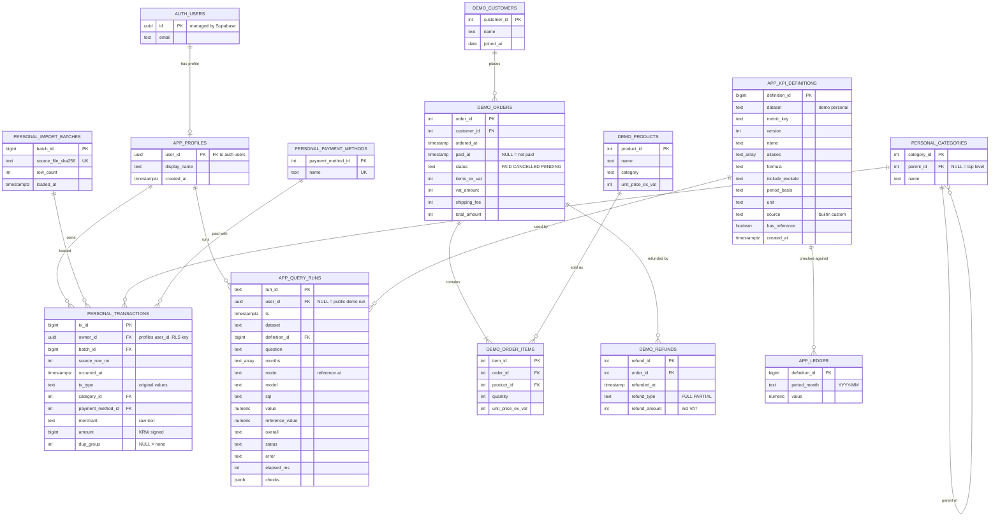
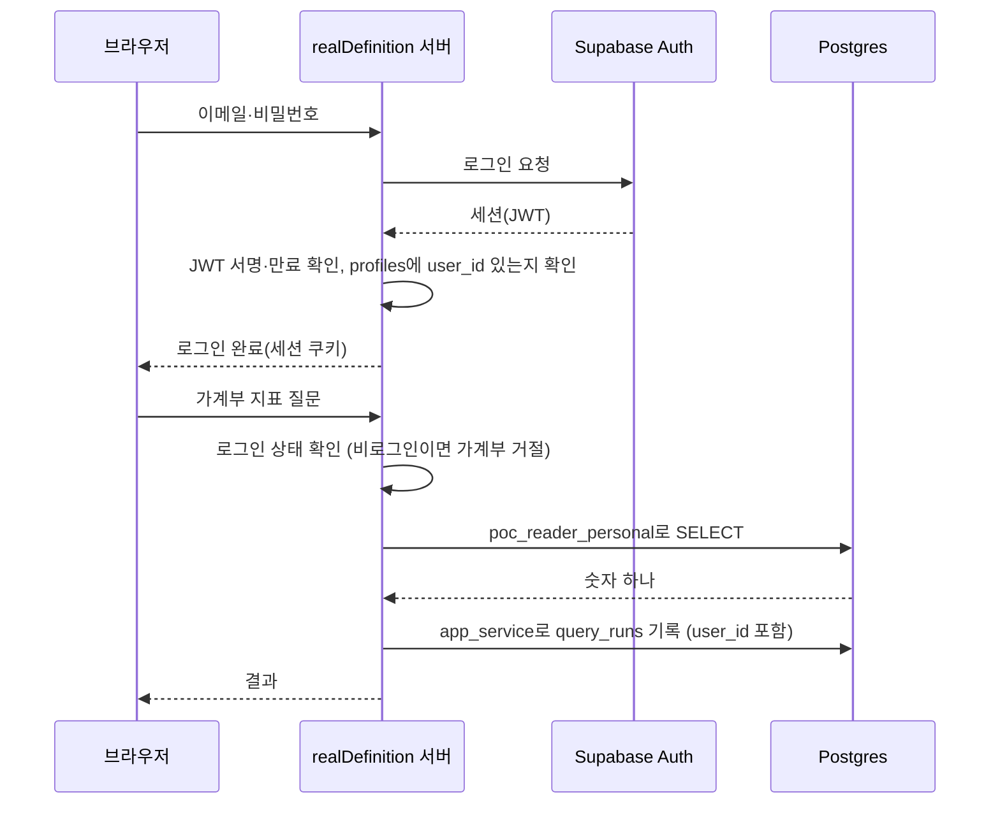

# realDefinition ERD

## 요약
[13 문서](docs/13-supabase-db-plan.md)의 ERD에 **로그인(Supabase Auth)** 을 더한 전체 구조입니다. 이전·적용은 하지 않았고 설계만 있습니다. 이 파일이 ERD의 기준(최신)이며, 13 문서의 ERD는 로그인 도입 전 버전입니다.

## 로그인 결정 (인터뷰 Q1~Q6)
| # | 질문 | 결정 |
|---|---|---|
| Q1 | 방식 | Supabase Auth(이메일·비밀번호). 서버는 세션(JWT) 유효성만 확인하고, 가계부는 계속 서버가 직접 접속해 읽는다(ADR 0002 유지) |
| Q2 | 가입 범위 | 가입 화면 없음. 본인 계정 1개를 직접 만든다. 공개 데모(합성 데이터)는 비로그인 |
| Q3 | 로그 | `query_runs`에만 `user_id` 추가(비로그인 데모 실행은 NULL). 로그인 성공·실패 기록 테이블은 만들지 않음 |
| Q4 | 프로필·소유 | `app.profiles(user_id → auth.users)`를 만들고 `personal.transactions.owner_id`가 이를 가리킨다. role 컬럼 없음 |
| Q5 | 로그인 필요 기능 | 가계부 계산·사용자 정의 지표 저장·실행 기록 조회는 로그인. 합성 데이터 계산은 비로그인 가능, 비로그인은 DB에 쓰는 경로 없음 |
| Q6 | 세션 | Supabase 기본 세션(JWT 1시간, 자동 갱신), 로그아웃 버튼 있음, 비밀번호 재설정 화면 없음(대시보드에서 직접) |

> 📘 **개념 학습 — Supabase Auth와 auth.users**
> - **Supabase Auth**: 이메일·비밀번호 확인, 비밀번호 암호화 저장, 로그인 세션 발급을 대신해 주는 서비스다.
> - **`auth.users`**: Auth가 관리하는 계정 테이블. 우리가 구조를 바꾸지 못하므로 우리 테이블은 이 테이블을 **직접 가리키지 않고** `profiles`를 사이에 둔다.
> - **JWT**: 로그인 성공 시 받는 "신분증 문자열". 서버는 서명이 유효한지, 만료되지 않았는지만 확인하면 누구인지 알 수 있다.
> - **`on delete cascade`**: 계정이 지워지면 프로필 행도 같이 지워지게 하는 설정.

## ERD

**읽는 법:** `AUTH_USERS`는 Supabase가 관리하는 테이블이라 우리 DDL로 만들지 않습니다. 13 문서와 달라진 곳은 **`APP_PROFILES` 추가, `owner_id`가 `profiles`를 가리킴, `query_runs.user_id` 추가** 세 가지입니다.

## 로그인 흐름

## 로그인에 따른 권한 변화 (14 문서 대비)
| 항목 | 이전(14 문서 S1) | 이번 |
|---|---|---|
| 본인 확인 | 서버 환경변수 토큰 | Supabase Auth 세션 + `profiles` 행 존재 |
| `owner_id` 출처 | 환경변수 고정 UUID | 로그인한 `profiles.user_id` |
| 가계부 RLS | `owner_id = <고정 UUID>` | `owner_id`가 `profiles`에 있는 값(서버가 접속 시 검증), 보조 방어선 |
| 사용자 정의 지표 저장 | 제한 없음 | 로그인 필요 |

## 열린 질문
- 서버가 세션(JWT)을 검증하는 구현 방법(Supabase 공개키로 직접 검증 vs Auth API 호출)은 구현 스펙에서 결정.
- 본인 계정에 이중 인증(MFA)을 켤지(이번 범위 밖).
- 사용자 정의 지표(`kpi_definitions`)에 작성자를 남길지(지금은 남기지 않음).

## 변경 이력
- 2026-10-20 초안 작성 (13 문서 ERD에 로그인 반영: profiles, owner_id FK, query_runs.user_id)
